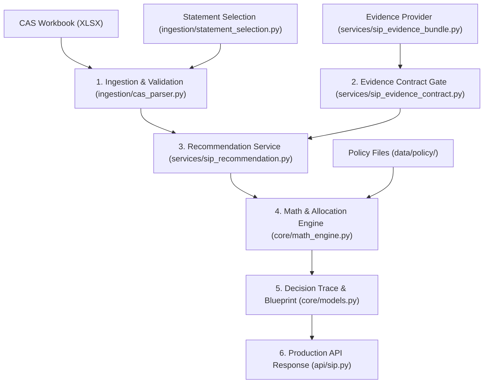

# Normative Architecture Specification

**Specification Version:** 1.0.0  
**Authority:** Normative architecture baseline for repository implementation, verification, and release gates.  
**Release Status:** NOT APPROVED FOR PRODUCTION (Read-only decision support and synthetic testing only).  
**Execution Authority:** NONE (Strictly non-executable; no broker, exchange, or payment integration).

---

## 1. Scope, Purpose, and Authority Boundaries

The Wealth Decision-Support Engine is a specialized computational system designed for:
- Deterministic ingestion, parsing, and reconciliation of Consolidated Account Statements (CAS).
- Fiduciary-grade suitability assessment, strategic asset allocation (SAA), and portfolio-aware Systematic Investment Plan (SIP) routing.
- Read-only decision support with auditable, reproducible mathematical traces.

### 1.1 Non-Executable Authority Boundary
The system does not possess trade execution, portfolio transaction, or funds-transfer authority:
- All proposal outputs represent non-binding decision support subject to independent human review.
- No direct connection to brokers, registrar/transfer agents (RTAs: CAMS/KFintech), AMCs, banks, or payment gateways exists or is permitted.
- Output artifacts (JSON recommendation blueprints, PDF summaries) explicitly carry non-executable disclaimers.

### 1.2 Data Handling — NO HARDCODING RULE (MANDATORY)

**Hardcoding of fund names, scheme codes, NAV values, portfolio values, ISINs, or any user-specific data is STRICTLY PROHIBITED anywhere in the codebase.**

- Every user uploads their own CAS (Consolidated Account Statement). Every CAS is different.
- The application MUST dynamically parse whatever funds exist in the uploaded CAS.
- There is NO demo data, NO fallback data, NO sample portfolios.
- If no CAS is uploaded, the app shows a prompt to upload one. It does NOT fabricate data.
- Fund classification (equity/debt/hybrid, cap allocation) is derived at runtime from scheme names in the CAS, never from a hardcoded list.
- Any violation of this rule is a P0 defect.

### 1.3 Supported Scope and Exclusions
- **Supported Instruments:** Direct and Regular mutual fund schemes registered under SEBI regulations.
- **Excluded Instruments:** Direct equities, derivatives, commodities, cryptocurrencies, unlisted securities, and foreign instruments without Indian domestic mutual fund structures.
- **Excluded Capabilities (Blocked):** Tax liability computation, exit-load optimization, and alpha claims remain disabled and fail-closed pending independent regulatory and tax review.

---

## 2. Canonical Application Entry Points and Startup Contracts

To resolve ambiguity between development tools, launchers, and APIs, the system defines one unambiguous startup contract per operating modality.

### 2.1 Summary of Supported Entry Points

| Entry Point | Modality | Primary Responsibility | Calling Contract / Command | Safety Boundary |
| :--- | :--- | :--- | :--- | :--- |
| `api/sip_production.py` | Programmatic API | Production REST service for SIP recommendation proposals. | `uvicorn api.sip_production:app --port 8000` | Accepts multipart CAS and client parameters; returns deterministic JSON blueprints. |
| `app.py` | UI Launcher | Development launcher for Streamlit web interface. | `python app.py` | Spawns `streamlit run ui/app.py --server.port 8501`. Does not contain financial logic. |
| `ui/app.py` | UI Root Screen | Renders the canonical legacy retirement notice. | `streamlit run ui/app.py` | Retired dashboard notice; prevents unvalidated legacy planning pages from executing. |
| `ui/pages/1_AI_Settings.py` | UI Configuration | Local management of free AI provider credentials. | Auto-discovered by Streamlit under `ui/app.py`. | Stores keys exclusively in local Git-ignored `.env`. Never displays stored secrets. |
| `advisor.py` | CLI Tool | Offline path resolver for verified client workbooks. | `python advisor.py` | Requires explicit external `MF_CLIENT_DATA_DIR`; strictly rejects in-tree client paths. |

### 2.2 Retired Entry Points (Fail-Closed)
The following historical scripts are retired and must not be used:
- `advisor_lean.py` & `legacy/advisor_lean_cli.py`: Historical unvalidated CLI drivers.
- `ui/pages/page_upload.py`, `page_profile.py`, `page_goals.py`, `page_report.py`: Deleted legacy dashboard pages. Restoring these pages is strictly prohibited.

---

## 3. Subsystem Architecture and Data Flow

The system operates as a pipeline of decoupled, fail-closed subsystems. Every stage verifies its inputs and yields structured, immutable evidence bundles or deterministic failures.

### 3.1 Subsystem 1: CAS Ingestion and Statement Selection
- **Statement Selection (`ingestion/statement_selection.py`):**
  - Statements are evaluated strictly by their embedded `"To Date"` header, never lexical file names.
  - Fail-closed rule: Ambiguous statement dates, missing valuation headers, or future-dated statements are rejected.
- **CAS Parsing (`ingestion/cas_parser.py`):**
  - **Numeric Finiteness & Domain:** Every financial field (`current_value`, `invested_value`, `units`, `returns`, `stated_total`) is verified via `_num`. Values must be finite floats within valid sign domains (`current >= 0`, `units >= 0`, `invested >= 0`). `NaN` and `+/-Infinity` trigger immediate validation rejection.
  - **Transaction Taxonomy:** Transactions are mapped to strict canonical types: `PURCHASE`, `SIP`, `REDEMPTION`, `SWITCH_IN`, `SWITCH_OUT`, `STP_IN`, `STP_OUT`, `DIVIDEND`, `SWP`, `DIVIDEND_REINVEST`, and `CHARGES`.
  - **Charges vs. Units:** `CHARGES` (STT, stamp duty, turnover fees) are strictly cash-only events and must not alter scheme unit balances.
  - **Reversals & Unknowns:** Reversals, dishonours, and unmapped descriptions are classified as `UNKNOWN` and fail closed, preventing inaccurate ledger balances.
  - **PII Scrubbing:** Investor personal identity rows (Name, PAN, Phone, Email) are discarded upon stream read and are never preserved in parsed memory structures.

### 3.2 Subsystem 2: Evidence Provider Contract & Provenance
The SIP evidence provider boundary (`services/sip_evidence_contract.py`) enforces strict cryptographic and metadata provenance:
- **Mandatory Provenance Fields:** Every evidence payload must supply:
  - `scheme_master` & `scheme_master_source_bytes`
  - `metrics_path`, `metrics_source_metadata`, & `metrics_source_bytes`
  - `candidate_universe`, `candidate_universe_source`, & `candidate_universe_source_bytes`
  - `portfolio_disclosures_by_scheme_id` & `portfolio_disclosure_source_bytes_by_scheme_id`
  - `disclosure_as_of_date` (strict `datetime.date`, not string or timestamp)
- **Digest Verification:** Every source document is verified against its declared SHA-256 hash across original raw bytes.
- **Scheme Master Binding:** Candidates and existing holdings bind strictly to verified scheme records carrying:
  - Stable `scheme_id` and unique `isin`.
  - Official category, benchmark identity, and scheme structure (`Open Ended`, etc.).
  - Verified integer SEBI Riskometer score ($1 \le \text{Riskometer} \le 6$).
- **Direct-Plan Evidence:** Candidates must include reviewer-attested factsheet evidence (`AMC_FACTSHEET`) verifying Direct-plan status.

### 3.3 Subsystem 3: Deterministic Financial & Allocation Engine
Located in `core/math_engine.py`:
- **Exposure Bounds:** Scheme exposure metrics (`eq`, `debt`, `lc`, `mc`, `sc`) must be finite and within $[0.0, 100.0]\%$. Total asset allocation exposure must satisfy:
  $$\text{eq} + \text{debt} \le 100.0\%$$
- **Reconciled Client AUM:** Missing client AUM fails closed: `ValueError: Verified reconciled client AUM is required; missing AUM is not zero`.
- **Decimal Accounting:** Financial totals and allocation budgets preserve currency rounding guarantees without floating-point truncation.
- **Holdings Plan/Option Resolution:** Holdings are classified as `PlanType.DIRECT`, `PlanType.REGULAR`, or `PlanType.UNKNOWN`. No name-based regex or substring heuristics are permitted; plan status derives solely from verified scheme-master evidence.
- **Overlap Calculation:** True constituent-weight overlap across holdings; equal-weight proxies and unverified heuristics are prohibited.

### 3.4 Subsystem 4: Suitability & Central Allocation Policy
- **Policy Precedence:** Allocation targets derive exclusively from authoritative policy definitions in `data/policy/` (e.g., `saa_policy_v1.json`). No competing or hardcoded allocation constants are permitted in Python model classes.
- **Risk Profiles:** Supported profiles map to deterministic SAA targets (Conservative, Moderate, Aggressive).
- **Post-SIP Denominator Drift:** SAA drift minimization computes allocation gaps against the projected post-SIP total portfolio denominator, preventing over-concentration in small existing portfolios.
- **Tier 6 Authorization Gate:** 100% equity routing requires explicit, documented IPS authorization; otherwise, the engine fails closed to safe defensive allocation.

### 3.5 Subsystem 5: Whole-Budget HOLD Behavior
If any fiduciary prerequisite fails—including stale data, missing portfolio disclosures, unverified scheme identity, missing metrics provenance, or SAA divergence—the system enforces the **Whole-Budget HOLD Contract**:
- Status: `"HOLD"`
- Decision: `"NO_ACTION"`
- Allocated Budget: `INR 0.0`
- Unallocated Budget: Full requested monthly budget
- Explanatory Reasons: Emitted with detailed, auditable fiduciary invariants.

---

## 4. Trust Boundaries, Security, and Data Privacy

1. **Client Isolation:**
   - Production workloads and tests never commit client data to repository storage.
   - CAS statements uploaded to `api/sip_production.py` reside in isolated temporary directories (`tempfile.TemporaryDirectory`) and are unlinked immediately after request completion.
2. **AI Provider Trust Boundary:**
   - External LLM narratives are governed by `docs/FREE_ONLY_AI_PROVIDER_POLICY.md`.
   - The engine strictly uses verified zero-cost models. Live model pricing is revalidated (`force_refresh=True`) immediately before every completion call to prevent stale ID reuse.
   - Investor PII, raw account balances, and unmasked holding amounts are never forwarded to external AI prompt contexts.
3. **Secrets Management:**
   - API keys are injected via process environment variables (`REQUESTY_API_KEY`, `OPENROUTER_API_KEY`).
   - `.env` files are local to developer environments and strictly ignored by Git.

---

## 5. Blocked and Gated Capabilities (Known Gaps)

In accordance with Gate 0 and Gate 4 of `PRODUCTION_RELEASE_CHECKLIST.md`, the following modules are intentionally gated:
- **Tax Optimization (`tax/`):** The investor-facing tax optimizer remains disabled pending independent Indian tax-domain qualification.
- **TRI Benchmark Alpha Gate (`docs/TRI_REVIEWER_SIGNATURE_CONTRACT.md`):** TRI benchmark release approvals require detached Ed25519 signatures from an independent root of trust; provisional fixture tests remain gated.
- **Trade Execution:** Any automated order placement, API-based execution, or mandate fulfillment is blocked.

---

## 6. Review and Versioning Record

- **Version 1.0.0 (2026-11-04):** Approved normative architecture baseline establishing canonical startup contracts, subsystem data flows, and fail-closed fiduciary invariants.
