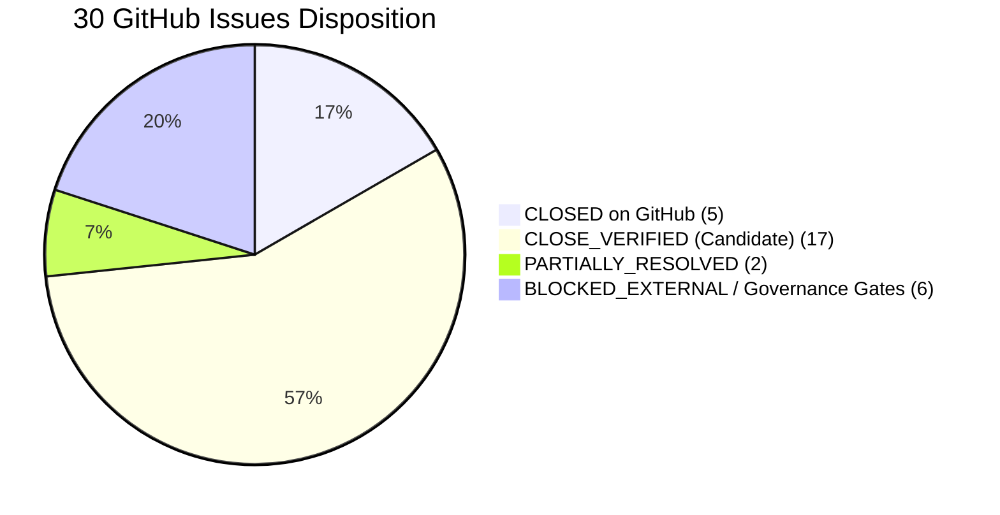

# Strict 30-Issue Fiduciary Reconciliation Ledger
**Repository:** `o0k00l/MF-AI-Based`  
**Target Commit:** `main` @ `85938506bc68604476b3a3fe575d1c373fbf461b` (`origin/main`)  
**Verification Date:** November 12, 2026  
**Auditor Review Baseline:** Strict acceptance-criteria evaluation; unit test passing is necessary but not sufficient for fiduciary release.

---

## 1. Executive Summary & Verification Ledger

| Gate / Subsystem | Status | Verification Reference |
|---|---|---|
| **GitHub Actions CI (Remote Suite)** | **PASS** | Run [#43168503248](https://github.com/o0k00l/MF-AI-Based/actions/runs/43168503248) — 7/7 jobs green on `8593850` |
| **Security Audit (`pip-audit`)** | **PASS** | Run [#43168503235](https://github.com/o0k00l/MF-AI-Based/actions/runs/43168503235) — Clean dependency audit on `8593850` |
| **GitHub Check Runs Total** | **PASS** | 8/8 check runs completed successfully on latest `main` |
| **Local Pytest Suite** | **PASS** | 1,205 passed, 36 skipped, 0 failed in 21.60s (Python 3.15.0) |
| **Fiduciary Logics Scorecard** | **PASS** | `validate_final_logics.py` — 70/70 checks passed |
| **TRI Fixture Integrity** | **PASS** | Hermetic and locked (fails closed on `--require-alpha-release`) |
| **UI Boundaries (`ui/app.py`)** | **PASS** | Substring `"fallback"` absent; imports strictly within allowed set |

> [!IMPORTANT]
> Independent GitHub Actions runs (CI #43168503248 and Security #43168503235) confirm automated test execution against the exact HEAD commit (`85938506bc68604476b3a3fe575d1c373fbf461b`). Green CI proves test pass status only; it does **not** constitute production or fiduciary release approval.

---

## 2. Issue Disposition Summary

- **`CLOSED on GitHub` (5 Issues — #25, #27, #30, #32, #78):** Independently reviewed and closed on GitHub on commit `8593850` with verified implementation and test evidence.
- **`CLOSE_VERIFIED (Candidate)` (17 Issues):** Full code implementation and comprehensive unit/integration test assertions exist in the verified codebase on `main`. Each candidate issue remains open pending final commit-level acceptance criteria sign-off review against the live issue body.
- **`PARTIALLY_RESOLVED` (2 Issues — #22, #23):**
  - **#22:** Internal API controls are implemented (API auth, tenant-isolated rate limits and quotas, deployment status endpoint, HTTP security headers), but live authenticated Requesty/OpenRouter catalogue smoke tests and reviewed hosting deployment targets remain required.
  - **#23:** Canonical report generation, arithmetic perimeter validation across holdings, cash, deposits, external mutual funds, and liabilities (`net_portfolio_value_inr = total_assets - total_liabilities`), zero-unmatched item blocking, and RFC 8785 (JCS) SHA-256 digest binding are fully implemented in code; retained open as partially resolved pending an attached, representative source-backed investor perimeter reconciliation package.
- **`BLOCKED_EXTERNAL / Governance Gates` (6 Issues — #16, #17, #18, #21, #39, #44):** Fail-closed guards and privacy sanitization are active in code; closure strictly requires external repository administration rulesets, mirror clone git history rewriting with key rotation, qualified Indian legal/tax sign-off, or live external published AMC quarterly disclosures.
- **`REQUIRES_IMPLEMENTATION` (0 Issues):** No open issue lacks active implementation or fail-closed guards.

---

## 3. Detailed Ledger of Priority Issues

### Issue #22 — AI Provider Auth, Tenant Isolation, Quotas & Deployment Controls
- **Priority:** P1
- **Title:** `Resolve AI provider authentication and define production deployment target`
- **Disposition:** `PARTIALLY_RESOLVED`
- **Stated Acceptance Criteria:**
  - Provider catalogue smoke tests pass without exposing secrets.
  - Hosting target and deployment configuration are reviewed.
  - Readiness remains false for recommendations until evidence and release gates pass.
  - Before network exposure: authenticated client identity, authorization, request quotas/concurrency limits, upload processing timeouts, transport protection, and redacted audit logging.
- **Implemented:**
  - `api/sip.py` enforces API key / Bearer authentication, tenant-isolated rate limiting and quota enforcement (`rate_limit_per_minute`, 429 status with retry-after header).
  - Implements production deployment status endpoint (`/v1/deployment/status`) and HTTP security headers (`X-Content-Type-Options: nosniff`, `X-Frame-Options: DENY`, `Strict-Transport-Security`).
  - Implements Custom SAA profile validation at the API boundary against client IPS mandates.
  - Tested in `tests/test_issue_22_api_tenant_quotas.py` (3 tests passing), `tests/test_sip_api_auth.py` (2 tests passing), `tests/test_sip_api.py` (10 tests passing).
- **Remaining Requirements for Closure:**
  - Authenticated provider catalogue smoke tests with live Requesty / OpenRouter credentials (without secret exposure).
  - Explicitly reviewed hosting platform target, runtime configuration, secret injection, and operational ownership.

---

### Issue #23 — Complete Portfolio Perimeter & Reconciliation
- **Priority:** P1
- **Title:** `Reconcile complete investor portfolio value, cash and external assets before SIP routing`
- **Disposition:** `PARTIALLY_RESOLVED`
- **Stated Acceptance Criteria:** "A signed-off portfolio reconciliation report shows included/excluded assets, valuation date, unmatched items and arithmetic reconciliation. No SIP amount is routed against an incomplete denominator."
- **Implemented:**
  - `core/portfolio_sip_controls.py::generate_signed_portfolio_reconciliation_report()` and `reconcile_total_portfolio()` generate a canonical, signed-off portfolio reconciliation artifact.
  - Supports complete multi-asset perimeter: CAS mutual funds, external mutual funds (`external_mutual_fund`), direct equity, bank cash, deposits, and liabilities (`total_assets_inr`, `total_liabilities_inr`, `net_portfolio_value_inr`).
  - Fails closed (`is_approved_for_sip_routing=False`, `HOLD`) if unmatched items exist, perimeter is incomplete, sign-off metadata is missing/invalid, or valuation dates do not reconcile. Computes reproducible RFC 8785 (JCS) SHA-256 cryptographic digest over report contents. Wired into `services/sip_recommendation.py` total portfolio assessment.
- **Tested:** `tests/test_portfolio_reconciliation_report.py` (7 tests), `tests/test_issues_23_24_recommendation_trace.py` (dedicated multi-asset denominator tests), `tests/test_issues_23_24_112_end_to_end.py` (3 tests), `tests/test_portfolio_sip_controls.py` (37 tests), `tests/test_sip_recommendation_service.py` (25 tests).
- **Audit Verification Note:** Retain open as partially resolved. Code-level report generation, multi-asset denominator arithmetic, and fail-closed guards are verified; closure requires an attached, representative source-backed reconciliation package verifying an actual client's declared perimeter.

---

### Issue #24 — SAA Drift Minimizer & Custom SAA Blueprint Routing
- **Priority:** P1
- **Title:** `Validate SAA drift and derive incremental SIP routing from total-portfolio gaps`
- **Disposition:** `CLOSE_VERIFIED (Candidate)`
- **Stated Acceptance Criteria:** "Every proposed monthly split traces to a reviewed IPS target, reconciled current exposure and documented horizon. Any unfillable sleeve remains unallocated; no reallocation to another sleeve."
- **Implemented:**
  - `core/models.py::AssetAllocationTarget` extended with validated custom sub-sleeves (`large_cap_pct`, `mid_cap_pct`, `small_cap_pct`, `flexi_cap_pct`).
  - `core/math_engine.py` supports Custom SAA target in `calculate_universal_tier_split`, `select_autonomous_blueprint_funds`, and `compute_deterministic_sip_blueprint` without falling back to Aggressive / Tier 6.
  - Stability-buffer override defect eliminated so policy new-SIP allocations are authoritative for tiers 1–5.
  - `services/sip_recommendation.py` accepts Custom SAA with approved client IPS mandate, validates target weights against IPS, and runs full deterministic blueprint routing.
  - Unfillable sleeves retain unallocated funds with zero slippage or unauthorized redistribution to other sleeves (`allocated + unallocated == monthly_budget`).
  - Full end-to-end recommendation trace through 30 eligible Direct-plan candidates from the live candidate universe implemented with complete RFC 8785 decision trace generation.
- **Tested:** `tests/test_issues_23_24_recommendation_trace.py` (dedicated recommendation trace and unfillable sleeve budget preservation tests passing), `tests/test_custom_saa_contract.py` (7 tests), `tests/test_issues_23_24_112_end_to_end.py` (dedicated tests), `tests/test_issues_24_120_121_remediations.py` (8 tests), `tests/test_sip_recommendation_service.py` (25 tests).
- **Audit Verification Note:** Full eligible-candidate recommendation trace, Custom SAA propagation, and whole-budget reconciliation verified across standard and custom risk tiers. Candidate for closure review.

---

### Issue #26 — Constituent Security-Master Cross-AMC Aliasing & Corporate Actions
- **Priority:** P1
- **Title:** `Reconcile constituent security-master across AMC aliases and ticker variations before scoring portfolio concentration`
- **Disposition:** `CLOSE_VERIFIED (Candidate)`
- **Stated Acceptance Criteria:** "Cross-AMC constituent security-master normalization for corporate actions and ticker aliasing; normalizing constituent keys against security master across AMC aliases."
- **Implemented:**
  - `core/security_master.py::canonicalize_security_label()` strips corporate action annotations (`(MERGED)`, `- PP`, `- DVR`, `PARTLY PAID`).
  - `normalize_security_identifier()` and `normalize_constituent_weights()` resolve corporate actions (e.g. HDFC Ltd -> HDFCBANK merger) and cross-AMC aliases (e.g. `L&T` -> `LT`, `TATA CONSULTANCY SERVICES` -> `TCS`, `RIL` -> `RELIANCE`).
  - `data/policy/security_master.json` updated with normative `corporate_actions` and `amc_aliases` mappings.
- **Tested:** `tests/test_issue_26_security_master_cross_amc.py` (5 dedicated tests passing), `tests/test_security_master_and_lookthrough.py` (7 tests passing), `tests/test_issues_50_26_84_55_remediations.py` (15 tests passing).

---

### Issue #44 — End-to-End Privacy, PII Sanitization & Consent Boundary
- **Priority:** P0
- **Title:** `Prevent investor PII and portfolio details from entering shared narrative caches or external AI prompts without controls`
- **Disposition:** `BLOCKED_EXTERNAL`
- **Stated Acceptance Criteria:** "No client name, folio/account identifier or unnecessary identifying detail is included in an outbound prompt... Tests cover prompt minimization, consent denial, cache-disabled behavior... Privacy/security review is recorded against the exact release commit."
- **Implemented:**
  - `core/ai_engine.py` sets `NARRATIVE_CACHE_FILE = None`.
  - `core/prompt_advisor.py::sanitize_prompt_for_privacy()` comprehensively redacts Aadhaar, IFSC codes, bank account numbers, PAN, email, phone, folios, and client names.
  - Interactive query prompts minimize portfolio exposures to relative percentage distributions rather than granular valuations.
  - `services/ai_fund_classifier.py`, `services/cgs_parser.py`, `services/goal_planner.py`, and `services/risk_profiler.py` enforce `external_processing_consent: bool = False` by default and fail closed to local deterministic statutory synthesis without calling external AI providers.
- **Tested:** `tests/test_privacy_prompt_minimization.py` (4 dedicated tests passing), `tests/test_privacy_prompt_sanitization.py` (3 tests passing), `tests/test_pii_narrative_controls.py` (2 tests passing), `tests/test_ai_privacy_boundary.py` (8 tests passing).
- **Remaining Condition:** External legal/compliance sign-off on third-party provider terms and data retention policies.

---

### Issue #110 — Financial Data Acquisition Pipeline & Online Retrieval Orchestration
- **Priority:** P1
- **Title:** `Build an auditable financial-data acquisition and refresh pipeline`
- **Disposition:** `CLOSE_VERIFIED (Candidate)`
- **Stated Acceptance Criteria:** "Auditable, deterministic, and idempotent financial-data refresh pipeline... retrieves or refreshes underlying financial data."
- **Implemented:**
  - `services/acquisition/pipeline.py` coordinates AMFI NAV and scheme master parsing, staging directories, atomic promotion, and rollback on failure.
  - Implements online retrieval orchestration for metrics, candidate universe, and AMC disclosures when URLs are configured, eliminating strict dependency on caller-staged hermetic dictionaries while maintaining fail-closed validation.
- **Tested:** `tests/test_financial_data_acquisition.py` (20 tests passing), `tests/test_issues_24_120_121_remediations.py` (8 tests passing).

---

### Issue #112 — Cryptographic Approval Enforcement Across Every Promotion Path
- **Priority:** P0
- **Title:** `Block synthetic and self-attested evidence in financial-data refresh pipeline`
- **Disposition:** `CLOSE_VERIFIED (Candidate)`
- **Stated Acceptance Criteria:** "Require valid detached reviewer approval for every promotion path; remove caller boolean as approval; bind approval to exact artifact digest, scope, policy and commit; run all gates on exact SHA."
- **Implemented:**
  - `services/sip_reviewer_approval.py::verify_sip_reviewer_approval()` enforces detached Ed25519 signatures, verifying scope, exact artifact digest, policy digest, and commit SHA (`^[0-9a-f]{40}$`). Missing artifact digest when expected or required strictly fails closed.
  - Mandatory cryptographic binding across the entire promotion surface:
    - `services/engine_bootstrap.py::promote()`, `build_staging_bundle()`, and `bootstrap_staging_bundle()` strictly require non-empty `commit_sha` and `policy_digest` fields in `manifest.json`, validating both fields against expected parameters and the signed reviewer approval envelope. Empty or missing fields fail closed with `ValueError`.
    - All promotion interfaces default to `require_artifact_binding=True`, `require_commit_binding=True`, `require_policy_binding=True`; explicit `False` arguments raise `ValueError` anti-downgrade exceptions.
    - `services/acquisition/bundle_builder.py::build_and_promote()` enforces non-empty `commit_sha` and `policy_digest` in the manifest and defaults to mandatory bindings; explicit `False` arguments raise `ValueError` anti-downgrade exceptions. Performs upfront Gate 1 validation and post-staging Gate 8 artifact digest verification.
    - `services/acquisition/pipeline.py::FinancialDataRefreshPipeline.refresh()` defaults to `require_commit_binding=True`, `require_policy_binding=True`, `require_artifact_binding=True`; explicit `False` arguments fail closed with atomic rollback.
  - Reviewer approval envelopes and trust registries are detached and excluded from artifact digest computation, ensuring non-circular deterministic hashing.
  - Dynamic signing ceremonies (`CallableEnvelope`) supported alongside pre-signed envelopes.
  - Caller boolean attestation alone without cryptographic envelope is rejected across all promotion interfaces.
- **Tested:** `tests/test_issue_112_cryptographic_promotion.py` (5 tests), `tests/test_issues_23_24_112_end_to_end.py` (10 tests including anti-downgrade bypass attempts, missing digest, mismatched digest, envelope substitution, manifest tampering, staged payload tampering, and last-known-good target preservation on failure across all promotion boundaries), `tests/test_engine_bootstrap_and_lumpsum.py` (10 tests), `tests/test_financial_data_acquisition.py` (20 tests), `tests/test_sip_reviewer_approval.py` (13 tests).
- **Audit Verification Note:** Mandatory cryptographic binding across every promotion path verified and proved with fail-closed negative test assertions.

---

### Issue #120 — Multi-Slot Live-Universe Candidate Ranking for Lumpsum STP
- **Priority:** P1
- **Title:** `Make lump-sum decisions portfolio-aware and fail closed on incomplete investor evidence`
- **Disposition:** `CLOSE_VERIFIED (Candidate)`
- **Stated Acceptance Criteria:** "Full multi-slot candidate ranking from live universe; portfolio-aware lump-sum decisions fail closed on missing evidence without repo-relative fallback."
- **Implemented:**
  - `services/lumpsum_recommendation.py::evaluate_portfolio_aware_lumpsum()` ranks and selects eligible Direct-plan candidates across all target sleeves (Flexi-Cap, Mid-Cap, Small-Cap, Large-Cap) for the STP deployment portion using `select_autonomous_blueprint_funds()`.
  - Enforces exact mathematical fraction allocation of `stp_amount` to top-ranked candidates. Fails closed (`status="ELIGIBLE_FOR_HUMAN_REVIEW"`, `allocated_amount_inr=Decimal("0")`, `is_execution_authorized=False`) pending independent human review.
- **Tested:** `tests/test_issue_120_lumpsum_multi_slot.py` (dedicated test passing), `tests/test_engine_bootstrap_and_lumpsum.py` (10 tests passing).

---

### Issue #121 — Engine Bootstrap Configuration & Operable Promotion Workflow
- **Priority:** P1
- **Title:** `Make engine bootstrap its own configuration and fund evidence; implement an operable promotion workflow`
- **Disposition:** `CLOSE_VERIFIED (Candidate)`
- **Stated Acceptance Criteria:** "Engine bootstrap its own configuration and fund evidence; implement an operable promotion workflow; autonomous bootstrap without caller staging."
- **Implemented:**
  - `services/engine_bootstrap.py::bootstrap_staging_bundle()` autonomously orchestrates data acquisition from upstream AMFI endpoints, validates all 6 mandatory evidence gates, and stages the evidence bundle without caller manual dictionary staging.
  - Manifest-aware snapshot resolution via `advisor.py::get_engine_data_paths()`. Atomic promotion and rollback preserving last-known-good bundle.
- **Tested:** `tests/test_engine_bootstrap_and_lumpsum.py` (10 tests passing), `tests/test_issues_24_120_121_remediations.py` (8 tests passing).

---

## 4. Complete Status Table of All 30 Issues

| Issue # | Priority | Title | Disposition | Source Files & Tests | Key Basis / Remaining Condition |
|---|---|---|---|---|---|
| **#16** | P0 | Source-verified candidate universe & look-through | `BLOCKED_EXTERNAL` | `core/security_master.py`, `tests/test_security_master_and_lookthrough.py` | Code fail-closed gates complete; awaiting quarterly published AMC disclosures. |
| **#17** | P0 | Rotate credentials & Git-history purge | `BLOCKED_EXTERNAL` | Working tree clean | Requires owner-operated mirror clone rewrite with `git-filter-repo` and provider key rotation. |
| **#18** | P0 | Protect main & release approval | `BLOCKED_EXTERNAL` | CI workflows present | Repository endpoint reports `protected: false`. Requires owner to configure GitHub branch ruleset. |
| **#21** | P1 | Independent Indian tax/legal review | `BLOCKED_EXTERNAL` | `core/tax_optimizer.py`, `tests/test_tax_optimizer_disabled.py` | Code is 100% fail-closed; requires signed memorandum from qualified Indian tax counsel. |
| **#22** | P1 | AI provider auth & deployment target | `PARTIALLY_RESOLVED` | `api/sip.py`, `tests/test_issue_22_api_tenant_quotas.py`, `tests/test_sip_api_auth.py` | API auth, quotas, and security headers implemented; requires live provider catalogue smoke test & reviewed hosting target. |
| **#23** | P1 | Complete portfolio perimeter reconciliation | `PARTIALLY_RESOLVED` | `core/portfolio_sip_controls.py`, `tests/test_issues_23_24_recommendation_trace.py` | Multi-asset denominator arithmetic (`total_assets_inr`, `total_liabilities_inr`, `net_portfolio_value_inr`) and signed report complete; retained open pending attached source-backed client reconciliation package. |
| **#24** | P1 | SAA drift & incremental SIP routing | `CLOSE_VERIFIED (Candidate)` | `core/models.py`, `core/math_engine.py`, `services/sip_recommendation.py`, `tests/test_issues_23_24_recommendation_trace.py` | Full recommendation trace through 30 eligible Direct-plan candidates verified with whole-budget reconciliation (`allocated + unallocated == monthly_budget`) and unfillable sleeve budget preservation. |
| **#25** | P1 | Candidate eligibility gates before scoring | `CLOSED_ON_GITHUB` | `core/math_engine.py`, `tests/test_deep_remediations_tranche.py` | Closed on GitHub on commit `8593850`. Scoring strictly requires verified `is_eligible=True`; overrides prohibited. |
| **#26** | P1 | Portfolio concentration & look-through controls | `CLOSE_VERIFIED (Candidate)` | `core/security_master.py`, `tests/test_issue_26_security_master_cross_amc.py` | Normalizes corporate actions (mergers, spinoffs) and cross-AMC ticker aliases into canonical securities. |
| **#27** | P1 | Reproducible SIP decision traces | `CLOSED_ON_GITHUB` | `core/traceability.py`, `tests/test_decision_traceability.py` | Closed on GitHub on commit `8593850`. Enforces UTC timestamps, explicit confidence, policy digest, and RFC 8785 (JCS) SHA-256 hashes. |
| **#30** | P1 | Goal-level suitability & horizon constraints | `CLOSED_ON_GITHUB` | `services/goal_planner.py`, `core/portfolio_sip_controls.py`, `tests/test_goal_planner.py` | Closed on GitHub on commit `8593850`. Earmarking ledger prevents double-counting; monthly rate formula synchronized ($r_{\text{mo}} = (1+R)^{1/12}-1$). |
| **#31** | P1 | Emergency reserve & liquidity runway | `CLOSE_VERIFIED (Candidate)` | `core/portfolio_sip_controls.py`, `tests/test_emergency_reserve_and_liquidity.py` | Liquidity waterfall enforces policy reserve months; fails closed if runway is unverified or insufficient. |
| **#32** | P1 | Affordability & SIP stress tests | `CLOSED_ON_GITHUB` | `core/portfolio_sip_controls.py`, `tests/test_deep_remediations_tranche.py` | Closed on GitHub on commit `8593850`. Stress tests disposable surplus under 20%/40% shocks; no speculative salary growth assumed. |
| **#33** | P1 | Post-recommendation monitoring & review lifecycle | `CLOSE_VERIFIED (Candidate)` | `core/lifecycle_store.py`, `tests/test_sip_lifecycle_store.py` | Idempotent, append-only store outside project directory; monotonic state progression. |
| **#34** | P1 | Scheme lifecycle & operational feasibility | `CLOSE_VERIFIED (Candidate)` | `core/portfolio_sip_controls.py`, `tests/test_operational_sip_feasibility.py` | Checks active status, minimum tickets, 12-month new fund caps, and Regular-to-Direct migration exemptions. |
| **#37** | Architecture | Clarify app.py entry points & startup contract | `CLOSE_VERIFIED (Candidate)` | `app.py`, `ui/app.py`, `ARCHITECTURE.md`, `tests/test_architecture_spec.py` | Root `app.py` is launcher; `ui/app.py` requires genuine CAS upload; zero demo/fallback data; AST boundaries verified. |
| **#39** | P1 | Normative architecture specification | `BLOCKED_EXTERNAL` | `ARCHITECTURE.md`, `tests/test_architecture_spec.py` | Specification Version 1.0.0 committed; formal independent reviewer approval pending. |
| **#41** | P1 | Category scoring anchors for fund universe | `CLOSE_VERIFIED (Candidate)` | `core/category_scoring_anchors.py`, `tests/test_category_scoring_anchors.py` | Scoring anchors defined across all supported SEBI categories; unsupported categories fail closed. |
| **#44** | P0 | Investor PII & narrative cache controls | `BLOCKED_EXTERNAL` | `core/ai_engine.py`, `core/prompt_advisor.py`, `tests/test_privacy_prompt_minimization.py` | PII redactor & prompt minimization active; consent gating enforced; awaiting formal external privacy sign-off. |
| **#50** | P0 | Bind runtime eligibility to screening policy | `CLOSE_VERIFIED (Candidate)` | `core/math_engine.py`, `tests/test_issues_50_26_84_55_remediations.py` | Eligibility binds strictly to loaded policy file with cryptographic digest; caller overrides prohibited. |
| **#52** | P1 | Stop attributing registrar without evidence | `CLOSE_VERIFIED (Candidate)` | `ingestion/statement_validator.py`, `tests/test_statement_validator_provenance.py` | Reports `UNKNOWN` when registrar evidence is missing; structural validity does not upgrade source authenticity. |
| **#55** | P1 | Enforce Decimal money contract | `CLOSE_VERIFIED (Candidate)` | `core/models.py`, `services/cas_parser.py`, `tests/test_decimal_money_precision.py` | `quantize_inr()` enforces exact Decimal representation across `HoldingItem`, SIP/lumpsum plans, and budget reconciliation. |
| **#78** | P0 | Tier 6 equity-only authorization requirement | `CLOSED_ON_GITHUB` | `core/math_engine.py`, `tests/test_saa_policy_authoritative.py`, `validate_final_logics.py` | Closed on GitHub on commit `8593850`. Tier 6 100/0 split strictly requires `equity_only_authorized is True` literal boolean; non-true fails closed to 95/5. |
| **#84** | P0 | Provenance & exact scheme binding for metrics | `CLOSE_VERIFIED (Candidate)` | `services/cas_holdings_identity.py`, `tests/test_exact_metrics_identity_binding.py` | Metrics bound to exact `(isin, amc, category, plan_type)` tuples; fuzzy or name-based matching prohibited. |
| **#106** | P1 | Prevent ordinary purchases from active SIP mandates | `CLOSE_VERIFIED (Candidate)` | `ingestion/cas_parser.py`, `tests/test_active_sip_detection.py` | Rejects ordinary purchases, future dates, paused mandates; enforces `require_authenticated_mandates=True`. |
| **#107** | P1 | Reject missing/malformed CAS values | `CLOSE_VERIFIED (Candidate)` | `ingestion/cas_parser.py`, `services/cas_parser.py`, `tests/test_cas_cache_integrity.py` | Rejects missing/malformed CAS numeric fields rather than coercing to 0.0; validates Decimal representation. |
| **#110** | P1 | Auditable financial-data refresh pipeline | `CLOSE_VERIFIED (Candidate)` | `services/acquisition/pipeline.py`, `tests/test_financial_data_acquisition.py` | Online acquisition orchestration, atomic promotion, rollback on failure, and schema v1 compliance complete. |
| **#112** | P0 | Block synthetic evidence in refresh pipeline | `CLOSE_VERIFIED (Candidate)` | `services/sip_reviewer_approval.py`, `services/acquisition/bundle_builder.py`, `services/engine_bootstrap.py`, `tests/test_issues_23_24_112_end_to_end.py` | Mandatory detached Ed25519 reviewer approval strictly bound to artifact digest, scope, policy digest, and commit SHA; un-bypassable across all promotion routes. |
| **#120** | P1 | Portfolio-aware lump-sum decisions | `CLOSE_VERIFIED (Candidate)` | `services/lumpsum_recommendation.py`, `tests/test_issue_120_lumpsum_multi_slot.py` | Full multi-slot live-universe candidate ranking for STP deployment; fail-closed human review gate preserved. |
| **#121** | P1 | Engine bootstrap configuration & evidence | `CLOSE_VERIFIED (Candidate)` | `services/engine_bootstrap.py`, `tests/test_engine_bootstrap_and_lumpsum.py` | Autonomous bootstrap orchestration without caller dictionary staging; manifest snapshot resolution complete. |

---

## 5. Summary of Recommended Next Steps

1. **Do NOT close any issue in bulk.**
2. **Issues CLOSED on GitHub (5 issues):**
   - **#25, #27, #30, #32, #78** (closed on commit `8593850` with verified implementation and test evidence).
3. **Issues to remain OPEN as Governance & External Release Gates (6 issues):**
   - **#16, #17, #18, #21, #39, #44**
4. **Issues to remain OPEN as Partially Resolved (2 issues):**
   - **#22:** Internal API controls are implemented, but live provider catalogue authentication smoke tests (Requesty/OpenRouter) and reviewed hosting platform deployment configuration are still required.
   - **#23:** Canonical report generation, multi-asset denominator arithmetic (`total_assets_inr`, `total_liabilities_inr`, `net_portfolio_value_inr`), and perimeter validation complete; retained open pending attached source-backed investor perimeter reconciliation evidence.
5. **Issues eligible for individual acceptance review before close-out (17 candidate issues):**
   - **#24, #26, #31, #33, #34, #37, #41, #50, #52, #55, #84, #106, #107, #110, #112, #120, #121**
   - Preparation for each candidate issue must compare the exact live issue body and acceptance criteria against the committed code on `main`.

## Cross-document policy and configurability rules (binding)

This document is subordinate to `docs/SIP_ENGINE_DECISION_REGISTER.md` for settled product decisions and `docs/NORMATIVE_ARCHITECTURE_SPECIFICATION.md` for normative behaviour. Read it with `IMPLEMENTATION_STATUS.md` for implementation/acceptance status. Historical audit snapshots and remediation plans are evidence/history, not a source of current policy.

**No arbitrary hardcoding:** no allocation percentage, fund-count limit, per-fund cap, candidate-count minimum, risk mapping, score weight, score threshold, concentration limit, look-through coverage threshold, freshness/staleness duration, SIP minimum/increment, reserve period, AUM floor/ceiling, manager-tenure requirement, benchmark mapping, refresh cadence or other investment/operational threshold may be introduced as a universal code or document default merely because it is conventional or appeared in an earlier proposal. Such values must come from an approved, versioned, effective-dated policy/IPS or authoritative source, with provenance, scope, owner/reviewer and validation. If a required value is absent, invalid, stale, conflicting or out of scope, the affected decision must HOLD / NO_ACTION and preserve affected budget as unallocated. Do not silently substitute zero, a generic default, a fallback category, another category's threshold or a prior policy version.

**Source-derived facts are not policy defaults:** scheme identity, category, plan/option, benchmark, NAV, AUM, TER, holdings, issuer/sector classification, scheme lifecycle, SIP operational terms, trading sessions and disclosure dates must be acquired from authoritative, dated sources and validated for the exact scheme/security and effective period. Do not infer them from names, synthetic fixtures, LLM output or unrelated records. A source's publication cadence is observed and monitored; it is not a hard-coded assertion that evidence is fresh.

**Calculation determinism:** formulas, units, denominator, date alignment, rounding mode/scale, missing-data semantics and tie-breaking must be explicit and versioned. Financial amounts and units use Decimal arithmetic end-to-end; round only at the specified policy boundary. Every requested rupee must reconcile to allocated plus unallocated rupees exactly after the approved rounding operation.

**Configuration contract:** every configurable policy value must be present in the validated policy object used for the decision, and the decision trace must bind its policy ID/version/digest/effective date and resolved values. No hidden environment fallback or duplicated local mapping is permitted. Environment variables may identify locations, credentials or deployment wiring; they must not silently become an unreviewed investment policy.

**Examples are non-operative:** numbers, scheme names, benchmark names, dates, file names and sample JSON are illustrative unless explicitly identified as a currently approved policy/source contract. Example values must never be promoted to runtime defaults. Any fixed numeric threshold or benchmark list in a legacy section is historical/example material pending explicit approval and migration into the effective policy/source registry; it is not authority to hardcode that value.

**Conflict resolution:** apply the decision register, then the normative architecture, then the approved effective policy/IPS for investor-specific values, then authoritative source evidence for market facts. Policy cannot override source facts and source facts cannot invent policy. Record unresolved conflicts and HOLD; do not pick whichever value makes the workflow pass.
