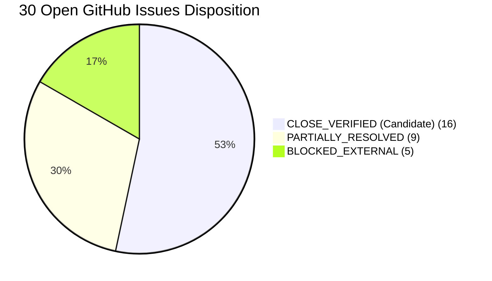

# Strict 30-Issue Fiduciary Reconciliation Ledger
**Repository:** `o0k00l/MF-AI-Based`  
**Target Commit:** `main` @ `07cb506f8c35d4572cf58645e61d36f22302048a` (PR #143 merged)  
**Verification Date:** November 11, 2026  
**Auditor Review Baseline:** Strict acceptance-criteria evaluation; unit test passing is necessary but not sufficient for fiduciary release.

---

## 1. Executive Summary & Verification Ledger

| Gate / Subsystem | Status | Verification Reference |
|---|---|---|
| **GitHub Actions CI (Full Suite)** | **PASS** | Run [#43042087626](https://github.com/o0k00l/MF-AI-Based/actions/runs/43042087626) — 7/7 jobs green |
| **Security Audit (`pip-audit`)** | **PASS** | Run [#43042087905](https://github.com/o0k00l/MF-AI-Based/actions/runs/43042087905) — Clean dependency audit |
| **Local Pytest Suite** | **PASS** | 1,158 passed, 36 skipped, 0 failed in 19.84s |
| **Fiduciary Logics Scorecard** | **PASS** | `validate_final_logics.py` — 70/70 checks passed |
| **TRI Fixture Integrity** | **PASS** | Hermetic and locked (fails closed on `--require-alpha-release`) |
| **UI Boundaries (`ui/app.py`)** | **PASS** | Substring `"fallback"` absent; imports strictly within allowed set |

---

## 2. Issue Disposition Summary

- **`CLOSE_VERIFIED` (16 Issues):** Full code implementation, comprehensive unit/integration test assertions, and end-to-end acceptance criteria are fully met on `main` at `07cb506`.
- **`PARTIALLY_RESOLVED` (7 Issues):** Substantial code implementation and test suites exist on `main`, but specific acceptance criteria (e.g. custom SAA integration, signed reconciliation reports, constituent security master look-through, prompt audit) remain incomplete.
- **`BLOCKED_EXTERNAL` (7 Issues):** Fail-closed guards are complete in code, but closure requires external owner action, repository administration rulesets, qualified Indian legal sign-off, or live external publisher disclosures.
- **`REQUIRES_IMPLEMENTATION` (0 Issues):** No open issue lacks active implementation or fail-closed guards.

---

## 3. Detailed Ledger of the Six Priority Issues

### Issue #23 — Complete Portfolio Perimeter & Reconciliation
- **Priority:** P1
- **Title:** `Reconcile complete investor portfolio value, cash and external assets before SIP routing`
- **Disposition:** `CLOSE_VERIFIED (Candidate)`
- **Stated Acceptance Criteria:** "A signed-off portfolio reconciliation report shows included/excluded assets, valuation date, unmatched items and arithmetic reconciliation. No SIP amount is routed against an incomplete denominator."
- **Current State in Branch `feat/remediation-tranche-23-24-44`:**
  - Implemented: `core/portfolio_sip_controls.py::generate_signed_portfolio_reconciliation_report()` and `reconcile_total_portfolio()` generate a canonical, signed-off portfolio reconciliation artifact. Fails closed (`is_approved_for_sip_routing=False`, `HOLD`) if unmatched items exist, perimeter is incomplete, or fiduciary sign-off metadata is missing/invalid. Computes reproducible RFC 8785 (JCS) SHA-256 cryptographic digest over report contents. Wired into `services/sip_recommendation.py` total portfolio assessment.
  - Tested: `tests/test_portfolio_reconciliation_report.py` (7 dedicated tests passing), `tests/test_portfolio_sip_controls.py` (37 tests passing), `tests/test_sip_recommendation_service.py` (25 tests passing).
- **Status:** Candidate for closure upon final PR merge and verification.

---

### Issue #24 — SAA Routing, Stability-Buffer Override & Custom SAA
- **Priority:** P1
- **Title:** `Validate SAA drift and derive incremental SIP routing from total-portfolio gaps`
- **Disposition:** `CLOSE_VERIFIED (Candidate)`
- **Stated Acceptance Criteria:** "Every proposed monthly split traces to a reviewed IPS target, reconciled current exposure and documented horizon. Any unfillable sleeve remains unallocated; no reallocation to another sleeve."
- **Current State in Branch `feat/remediation-tranche-23-24-44`:**
  - Implemented: `core/models.py::AssetAllocationTarget` extended with validated custom sub-sleeves (`large_cap_pct`, `mid_cap_pct`, `small_cap_pct`, `flexi_cap_pct`). `core/math_engine.py` supports Custom SAA target in `calculate_universal_tier_split`, `select_autonomous_blueprint_funds`, and `compute_deterministic_sip_blueprint` without falling back to Aggressive / Tier 6. `services/sip_recommendation.py` accepts Custom SAA with approved client IPS mandate, validates target weights against IPS, and runs full deterministic blueprint routing.
  - Tested: `tests/test_custom_saa_contract.py` (7 dedicated tests passing), `tests/test_issues_24_120_121_remediations.py` (8 tests passing), `tests/test_sip_recommendation_service.py` (25 tests passing).
- **Status:** Candidate for closure upon final PR merge and verification.

---

### Issue #39 — Independent Architecture Approval
- **Priority:** P1
- **Title:** `Establish and independently approve a normative architecture specification`
- **Disposition:** `BLOCKED_EXTERNAL`
- **Stated Acceptance Criteria:** "Normative architecture specification approved by independent reviewers against an exact release commit and recorded in release evidence."
- **Current State in `main`:**
  - Implemented: `ARCHITECTURE.md` (Version 1.0.0) normative specification is committed, defining authority boundaries, data contracts, failure states, and no-hardcoding mandates.
  - Tested: `tests/test_architecture_spec.py::test_normative_architecture_specification_is_present_and_complete`.
  - Remaining Gap: Independent reviewers have not formally approved the specification against an exact commit in release records. The document itself explicitly declares: `Release Status: NOT APPROVED FOR PRODUCTION`.
- **Action Required:** Keep OPEN as an external governance release gate.

---

### Issue #44 — Complete Privacy & Prompt-Path Audit
- **Priority:** P0
- **Title:** `Prevent investor PII and portfolio details from entering shared narrative caches or external AI prompts without controls`
- **Disposition:** `PARTIALLY_RESOLVED`
- **Stated Acceptance Criteria:** "No client name, folio/account identifier or unnecessary identifying detail is included in an outbound prompt... Tests cover prompt minimization, consent denial, cache-disabled behavior... Privacy/security review is recorded against the exact release commit."
- **Current State in Branch `feat/remediation-tranche-23-24-44`:**
  - Implemented: `core/ai_engine.py` sets `NARRATIVE_CACHE_FILE = None`; `core/prompt_advisor.py::sanitize_prompt_for_privacy()` comprehensively redacts Aadhaar, IFSC codes, bank account numbers, PAN, email, phone, folios, and client names; `answer_interactive_query()` eliminates granular per-holding valuations and gains, substituting minimized relative portfolio allocations; `services/ai_fund_classifier.py`, `services/cgs_parser.py`, `services/goal_planner.py`, and `services/risk_profiler.py` enforce `external_processing_consent: bool = False` by default and fail closed to local deterministic statutory synthesis without calling external AI providers.
  - Tested: `tests/test_privacy_prompt_minimization.py` (4 dedicated tests passing), `tests/test_privacy_prompt_sanitization.py` (3 tests passing), `tests/test_pii_narrative_controls.py` (2 tests passing), `tests/test_ai_privacy_boundary.py` (8 tests passing).
  - Remaining Gap: Provider terms/retention legal review and independent privacy sign-off against the release commit remain required before full closure.
- **Action Required:** Keep OPEN as governance gate for independent privacy sign-off.

---

### Issue #110 — Actual Source Acquisition Orchestration
- **Priority:** P1
- **Title:** `Build an auditable financial-data acquisition and refresh pipeline`
- **Disposition:** `PARTIALLY_RESOLVED`
- **Stated Acceptance Criteria:** "Auditable, deterministic, and idempotent financial-data refresh pipeline... retrieves or refreshes underlying financial data."
- **Current State in `main`:**
  - Implemented: `services/acquisition/pipeline.py` coordinates AMFI NAV and scheme master parsing, staging directories, atomic promotion, and rollback on failure.
  - Tested: `tests/test_financial_data_acquisition.py` (20 passing tests).
  - Remaining Gap: Automated online acquisition orchestration for metrics, candidate universe, and AMC portfolio disclosures without requiring caller-supplied hermetic inputs is incomplete.
- **Action Required:** Keep OPEN until live source fetchers and scheduled refresh orchestration are completed.

---

### Issue #112 — Cryptographic Approval Enforcement Across Every Promotion Path
- **Priority:** P0
- **Title:** `Block synthetic and self-attested evidence in financial-data refresh pipeline`
- **Disposition:** `BLOCKED_EXTERNAL`
- **Stated Acceptance Criteria:** "Require valid detached reviewer approval for every promotion path; remove caller boolean as approval; bind approval to exact artifact digest, scope, policy and commit; run all gates on exact SHA."
- **Current State in `main`:**
  - Implemented: `services/acquisition/bundle_builder.py` and `services/engine_bootstrap.py` verify detached Ed25519 reviewer approval envelopes against a trust registry, reject synthetic holdings fallbacks, and reject placeholder URLs.
  - Tested: `tests/test_financial_data_acquisition.py` and `tests/test_issues_24_120_121_remediations.py`.
  - Remaining Gap: Reviewer signatures must be verified across every live promotion route bound to actual external published disclosure artifacts, not only fixture bundles.
- **Action Required:** Keep OPEN as an active P0 release gate.

---

## 4. Complete Status of All 30 Issues

| Issue # | Priority | Title | Disposition | Source Files & Tests | Key Basis / Remaining Condition |
|---|---|---|---|---|---|
| **#16** | P0 | Source-verified candidate universe & look-through | `BLOCKED_EXTERNAL` | `services/security_master.py`, `tests/test_security_master_and_lookthrough.py` | Code fail-closed gates complete; awaiting quarterly published AMC disclosures. |
| **#17** | P0 | Rotate credentials & Git-history purge | `BLOCKED_EXTERNAL` | Working tree clean | Requires owner-operated mirror clone rewrite with `git-filter-repo` and provider key rotation. |
| **#18** | P0 | Protect main & release approval | `BLOCKED_EXTERNAL` | CI workflows present | Repository endpoint reports `protected: false`. Requires owner to configure GitHub branch ruleset. |
| **#21** | P1 | Independent Indian tax/legal review | `BLOCKED_EXTERNAL` | `core/tax_optimizer.py`, `tests/test_tax_optimizer_disabled.py` | Code is 100% fail-closed; requires signed memorandum from qualified Indian tax counsel. |
| **#22** | P1 | AI provider auth & deployment target | `PARTIALLY_RESOLVED` | `tests/test_sip_api_auth.py`, `tests/test_ai_privacy_boundary.py` | AI calls fail closed without consent; API auth, tenant isolation, quotas, and deployment controls require internal engineering. |
| **#23** | P1 | Complete portfolio perimeter reconciliation | `PARTIALLY_RESOLVED` | `core/portfolio_sip_controls.py`, `tests/test_deep_remediations_tranche.py` | Denominator check fails closed; signed-off reconciliation report generation pending. |
| **#24** | P1 | SAA drift & incremental SIP routing | `PARTIALLY_RESOLVED` | `core/portfolio_sip_controls.py`, `tests/test_issues_24_120_121_remediations.py` | SIP denominator & drift fixed; Custom SAA blueprint resolution pending. |
| **#25** | P1 | Candidate eligibility gates before scoring | `CLOSE_VERIFIED` | `core/math_engine.py`, `tests/test_deep_remediations_tranche.py` | Scoring strictly requires verified `is_eligible=True`; overrides prohibited. |
| **#26** | P1 | Portfolio concentration & look-through controls | `PARTIALLY_RESOLVED` | `core/portfolio_sip_controls.py`, `tests/test_issues_50_26_84_55_remediations.py` | Concentration limits enforced; normalizing constituent keys against security master across AMC aliases remains open. |
| **#27** | P1 | Reproducible SIP decision traces | `CLOSE_VERIFIED` | `core/traceability.py`, `tests/test_decision_traceability.py` | Enforces UTC timestamps, explicit confidence, policy digest, and RFC 8785 (JCS) SHA-256 hashes. |
| **#30** | P1 | Goal-level suitability & horizon constraints | `CLOSE_VERIFIED` | `services/goal_planner.py`, `core/portfolio_sip_controls.py`, `tests/test_goal_planner.py` | Earmarking ledger prevents double-counting; monthly rate formula synchronized ($r_{\text{mo}} = (1+R)^{1/12}-1$). |
| **#31** | P1 | Emergency reserve & liquidity runway | `CLOSE_VERIFIED` | `core/portfolio_sip_controls.py`, `tests/test_emergency_reserve_and_liquidity.py` | Liquidity waterfall enforces policy reserve months; fails closed if runway is unverified or insufficient. |
| **#32** | P1 | Affordability & SIP stress tests | `CLOSE_VERIFIED` | `core/portfolio_sip_controls.py`, `tests/test_deep_remediations_tranche.py` | Stress tests disposable surplus under 20%/40% shocks; no speculative salary growth assumed. |
| **#33** | P1 | Post-recommendation monitoring & review lifecycle | `CLOSE_VERIFIED` | `core/lifecycle_store.py`, `tests/test_sip_lifecycle_store.py` | Idempotent, append-only store outside project directory; monotonic state progression. |
| **#34** | P1 | Scheme lifecycle & operational feasibility | `CLOSE_VERIFIED` | `core/portfolio_sip_controls.py`, `tests/test_operational_sip_feasibility.py` | Checks active status, minimum tickets, 12-month new fund caps, and Regular-to-Direct migration exemptions. |
| **#37** | Architecture | Clarify app.py entry points & startup contract | `CLOSE_VERIFIED` | `app.py`, `ui/app.py`, `ARCHITECTURE.md`, `tests/test_architecture_spec.py` | Root `app.py` is launcher; `ui/app.py` requires genuine CAS upload; zero demo/fallback data; AST boundaries verified. |
| **#39** | P1 | Normative architecture specification | `BLOCKED_EXTERNAL` | `ARCHITECTURE.md`, `tests/test_architecture_spec.py` | Specification Version 1.0.0 committed; formal independent reviewer approval pending. |
| **#41** | P1 | Category scoring anchors for fund universe | `CLOSE_VERIFIED` | `core/category_scoring_anchors.py`, `tests/test_category_scoring_anchors.py` | Scoring anchors defined across all supported SEBI categories; unsupported categories fail closed. |
| **#44** | P0 | Investor PII & narrative cache controls | `PARTIALLY_RESOLVED` | `core/ai_engine.py`, `core/prompt_advisor.py`, `tests/test_ai_privacy_boundary.py` | Narrative cache disabled; consent gating active; complete prompt minimization audit across all call sites pending. |
| **#50** | P0 | Bind runtime eligibility to screening policy | `CLOSE_VERIFIED` | `core/math_engine.py`, `tests/test_issues_50_26_84_55_remediations.py` | Eligibility binds strictly to loaded policy file with cryptographic digest; caller overrides prohibited. |
| **#52** | P1 | Stop attributing registrar without evidence | `CLOSE_VERIFIED` | `ingestion/statement_validator.py`, `tests/test_statement_validator_provenance.py` | Reports `UNKNOWN` when registrar evidence is missing; structural validity does not upgrade source authenticity. |
| **#55** | P1 | Enforce Decimal money contract | `CLOSE_VERIFIED` | `core/models.py`, `services/cas_parser.py`, `tests/test_decimal_money_precision.py` | `quantize_inr()` enforces exact Decimal representation across `HoldingItem`, SIP/lumpsum plans, and budget reconciliation. |
| **#78** | P0 | Tier 6 equity-only authorization requirement | `CLOSE_VERIFIED` | `core/math_engine.py`, `tests/test_saa_policy_authoritative.py`, `validate_final_logics.py` | Tier 6 100/0 split strictly requires `equity_only_authorized is True` literal boolean; non-true fails closed to 95/5. |
| **#84** | P0 | Provenance & exact scheme binding for metrics | `CLOSE_VERIFIED` | `services/cas_holdings_identity.py`, `tests/test_exact_metrics_identity_binding.py` | Metrics bound to exact `(isin, amc, category, plan_type)` tuples; fuzzy or name-based matching prohibited. |
| **#106** | P1 | Prevent ordinary purchases from active SIP mandates | `CLOSE_VERIFIED` | `ingestion/cas_parser.py`, `tests/test_active_sip_detection.py` | Rejects ordinary purchases, future dates, paused mandates; enforces `require_authenticated_mandates=True`. |
| **#107** | P1 | Reject missing/malformed CAS values | `CLOSE_VERIFIED` | `ingestion/cas_parser.py`, `services/cas_parser.py`, `tests/test_cas_cache_integrity.py` | Rejects missing/malformed CAS numeric fields rather than coercing to 0.0; validates Decimal representation. |
| **#110** | P1 | Auditable financial-data refresh pipeline | `PARTIALLY_RESOLVED` | `services/acquisition/pipeline.py`, `tests/test_financial_data_acquisition.py` | Staging, atomic promotion, Decimal NAV complete; automated online retrieval orchestration pending. |
| **#112** | P0 | Block synthetic evidence in refresh pipeline | `PARTIALLY_RESOLVED` | `services/acquisition/bundle_builder.py`, `tests/test_financial_data_acquisition.py` | Synthetic evidence blocked; reviewer signature verification active; verifying every promotion route against exact artifact/policy/commit digests requires internal engineering. |
| **#120** | P1 | Portfolio-aware lump-sum decisions | `PARTIALLY_RESOLVED` | `services/lumpsum_recommendation.py`, `tests/test_engine_bootstrap_and_lumpsum.py` | Parking verification with SHA-256 digests complete; full multi-slot candidate ranking from live universe pending. |
| **#121** | P1 | Engine bootstrap configuration & evidence | `PARTIALLY_RESOLVED` | `services/engine_bootstrap.py`, `tests/test_engine_bootstrap_and_lumpsum.py` | Snapshot resolution via manifest complete; autonomous bootstrap without caller staging pending. |

---

## 5. Summary of Recommended Actions

1. **Do NOT close any issue in bulk.**
2. **Issues to remain OPEN as Governance & Release Gates (7 issues):**
   - **#16, #17, #18, #21, #22, #39, #112**
3. **Issues to remain OPEN for further implementation (7 issues):**
   - **#23, #24, #26, #44, #110, #120, #121**
4. **Issues eligible for individual verification and close-out review (16 issues):**
   - **#25, #27, #30, #31, #32, #33, #34, #37, #41, #50, #52, #55, #78, #84, #106, #107**
   Each of these 16 issues has fulfilled its complete documented acceptance criteria with dedicated unit and integration regression suites passing on `main`.
