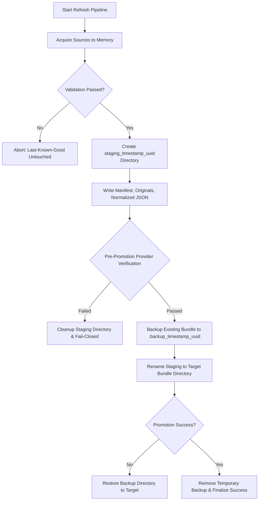

# Financial Data Acquisition and Refresh Pipeline Specification

## 1. Overview and Normative Purpose

The Mutual Fund SIP Advisory engine is strictly evidence-backed. Under SEBI regulations and fiduciary standards, investment recommendations cannot rely on unverified third-party estimates, real-time scraping without audit trails, or LLM-generated financial facts.

This specification documents the architecture, operational cadence, source licensing/authority, provenance binding, and atomic rollback guarantees of the financial data acquisition pipeline (`services/acquisition/`).

---

## 2. Upstream Source Inventory and Authority

| Component | Upstream Source & Canonical Endpoint | Legal / Regulatory Authority | Refresh Cadence | Ingestion Adapter |
| :--- | :--- | :--- | :--- | :--- |
| **Daily NAV Feed** | `https://www.amfiindia.com/spages/NAVAll.txt` | Association of Mutual Funds in India (AMFI) official public dissemination feed | Daily post 23:00 IST (business days) | `AmfiNavAdapter` |
| **Scheme Master** | `https://www.amfiindia.com/research-information/other-data/scheme-details` | AMFI official scheme classification & SEBI categorization master | Monthly / on scheme lifecycle changes | `AmfiSchemeMasterAdapter` |
| **Portfolio Disclosures** | AMC monthly portfolio disclosures / AMFI disclosure aggregator | SEBI circular SEBI/HO/IMD/DF2/CIR/P/2018/92 (mandatory 10th of each month) | Monthly (within 10 days of month-end) | `PortfolioDisclosureAdapter` |
| **Direct Plan Evidence** | Authoritative AMC scheme information documents (SID) & factsheets | Asset Management Companies (AMCs) registered with SEBI | Monthly / per factsheet release | Direct Plan Evidence validator |
| **Candidate Universe** | Curated direct equity schemes meeting fiduciary screening | Independent advisory research & SEBI-registered advisor signoff | Monthly / per review cycle | `CandidateUniverseAdapter` |

---

## 3. Cryptographic Provenance and Lineage Contract

All acquired data is converted into the immutable evidence bundle format (`schema_version: 1`) consumed by `services/sip_evidence_bundle.py`:

1. **Original Byte Retention**: Every downloaded source artifact is stored bit-for-bit in `originals/` within the bundle directory.
2. **Digest Verification**: SHA-256 digests are computed immediately upon receipt of raw bytes and recorded in metadata files (`metrics_metadata.json`, `candidate_metadata.json`, etc.).
3. **Normalized Artifact Binding**: Transformed JSON files (`metrics.json`, `candidates.json`) have their content digests recorded in metadata to prevent tampering between acquisition and engine execution.
4. **Attestation Requirements**: Data must carry explicit reviewer attestation (`reviewer_attested: true`) and verifiable reviewer signatures (`reviewer_approval_envelope`) when strict signature verification is active.

---

## 4. Freshness and Fail-Closed Validation Rules

The acquisition pipeline enforces fail-closed operations:
- **Maximum Staleness Window**: Evidence older than 45 days relative to the `as_of` date is rejected.
- **Future-Dated Rejection**: Any feed record with a timestamp or date ahead of the execution `as_of` date is rejected.
- **Non-Zero Finite NAV**: NAV values must be finite, strictly positive floating-point numbers. Non-numeric or missing NAVs (`"N.A."`, blank) are rejected.
- **Direct Plan Integrity**: Only schemes explicitly classified as `plan_type: "Direct"` and `option_type: "Growth"` are eligible for the SIP candidate universe.
- **Fail-Closed Budget Protection**: If any required source fails acquisition, validation, or attestation, the pipeline aborts. The SIP allocation engine preserves 100% of the client's budget unallocated.

---

## 5. Atomic Staging and Rollback Architecture

To ensure zero downtime, prevent race conditions, and protect existing good bundles:

### Safety Guarantees:
- **No Partial Overwrites**: Staging occurs outside the live path.
- **Pre-Promotion Gate**: `build_sip_evidence_provider` is invoked against the staging directory to guarantee that downstream parsers will accept the bundle before promotion.
- **Instant Rollback**: If filesystem promotion encounters an error, the backup directory is restored to the target location.

---

## 6. Operational Monitoring and Recovery

1. **Execution Logging**: Every execution produces an immutable `RefreshResult` recording status (`SUCCESS` or `FAILED`), record counts by source, timestamp, and diagnostic error messages.
2. **PII and Credential Exclusion**: Ingestion logs record only source identifiers, HTTP status codes, row counts, and cryptographic digests. Client portfolios, PII, and API secrets are never logged.
3. **Recovery Procedure**:
   - In case of pipeline failure, investigate the `RefreshResult.errors` list.
   - Verify upstream source availability (`https://www.amfiindia.com/spages/NAVAll.txt`).
   - If upstream published malformed data, retain the existing bundle until upstream rectifies the feed.
   - Use hermetic fixtures to verify that local code parser rules have not drifted from regulatory schema updates.
