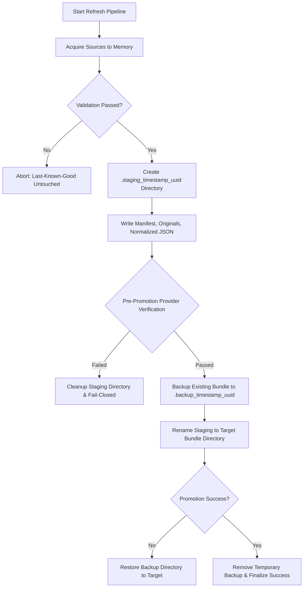

# Financial Data Acquisition and Refresh Pipeline Specification

## 1. Overview and Normative Purpose

The Mutual Fund SIP Advisory engine is strictly evidence-backed. Under SEBI regulations and fiduciary standards, investment recommendations cannot rely on unverified third-party estimates, real-time scraping without audit trails, or LLM-generated financial facts.

This specification documents the architecture, operational cadence, source licensing/authority, provenance binding, and atomic rollback guarantees of the financial data acquisition pipeline (`services/acquisition/`).

---

## 2. Upstream Source Inventory and Authority

| Component | Upstream Source & Canonical Endpoint | Legal / Regulatory Authority | Refresh Cadence | Ingestion Adapter |
| :--- | :--- | :--- | :--- | :--- |
| **Daily NAV Feed** | `https://www.amfiindia.com/spages/NAVAll.txt` | Association of Mutual Funds in India (AMFI) official public dissemination feed | After authoritative publication; monitor actual publication and exchange-session status | `AmfiNavAdapter` |
| **Scheme Master** | `https://www.amfiindia.com/research-information/other-data/scheme-details` | AMFI official scheme classification & SEBI categorization master | On authoritative publication and lifecycle events; enforce source-specific freshness policy | `AmfiSchemeMasterAdapter` |
| **Portfolio Disclosures** | AMC monthly portfolio disclosures / AMFI disclosure aggregator | SEBI circular SEBI/HO/IMD/DF2/CIR/P/2018/92 (mandatory 10th of each month) | On authoritative publisher release; validate applicable regulatory publication requirements and actual publication date | `PortfolioDisclosureAdapter` |
| **Direct Plan Evidence** | Authoritative AMC scheme information documents (SID) & factsheets | Asset Management Companies (AMCs) registered with SEBI | On authoritative publisher release; source-specific | Direct Plan Evidence validator |
| **Candidate Universe** | Engine-owned discovery and independently reviewed evidence; universe scope and release approval are versioned policy | Independent advisory research & SEBI-registered advisor signoff | Monthly / per review cycle | `CandidateUniverseAdapter` |

---

## 3. Cryptographic Provenance and Lineage Contract

All acquired data is converted into the immutable evidence bundle format (`schema_version: 1`) consumed by `services/sip_evidence_bundle.py`:

1. **Original Byte Retention**: Every downloaded source artifact is stored bit-for-bit in `originals/` within the bundle directory.
2. **Digest Verification**: SHA-256 digests are computed immediately upon receipt of raw bytes and recorded in metadata files (`metrics_metadata.json`, `candidate_metadata.json`, etc.).
3. **Normalized Artifact Binding**: Transformed JSON files (`metrics.json`, `candidates.json`) have their content digests recorded in metadata to prevent tampering between acquisition and engine execution.
4. **Attestation Requirements**: Data must carry explicit reviewer attestation (`reviewer_attested: true`) and verifiable reviewer signatures (`reviewer_approval_envelope`) when strict signature verification is active.

---

## 4. Freshness and Fail-Closed Validation Rules

The acquisition pipeline enforces fail-closed operations:
- **Evidence freshness**: each evidence type is checked against its approved, source-specific freshness policy and effective date. There is no universal 45-day window. Missing or invalid freshness policy, or evidence outside its approved window, blocks the affected decision.
- **Future-Dated Rejection**: Any feed record with a timestamp or date ahead of the execution `as_of` date is rejected.
- **Non-Zero Finite NAV**: NAV values must be finite and strictly positive, parsed and retained using exact decimal semantics; floating-point arithmetic is not permitted for financial values. Non-numeric or missing NAVs (`"N.A."`, blank) are rejected.
- **Direct Plan Integrity**: Only schemes explicitly classified as `plan_type: "Direct"` and `option_type: "Growth"` are eligible for the SIP candidate universe.
- **Fail-Closed Budget Protection**: If any required source fails acquisition, validation, or attestation, the pipeline aborts. The SIP allocation engine preserves 100% of the client's budget unallocated.

---

## 5. Atomic Staging and Rollback Architecture

To ensure zero downtime, prevent race conditions, and protect existing good bundles:

### Safety Guarantees:
- **No Partial Overwrites**: Staging occurs outside the live path.
- **Pre-Promotion Gate**: `build_sip_evidence_provider` is invoked against the staging directory to guarantee that downstream parsers will accept the bundle before promotion.
- **Instant Rollback**: If filesystem promotion encounters an error, the backup directory is restored to the target location.

---

## 6. Operational Monitoring and Recovery

1. **Execution Logging**: Every execution produces an immutable `RefreshResult` recording status (`SUCCESS` or `FAILED`), record counts by source, timestamp, and diagnostic error messages.
2. **PII and Credential Exclusion**: Ingestion logs record only source identifiers, HTTP status codes, row counts, and cryptographic digests. Client portfolios, PII, and API secrets are never logged.
3. **Recovery Procedure**:
   - In case of pipeline failure, investigate the `RefreshResult.errors` list.
   - Verify upstream source availability (`https://www.amfiindia.com/spages/NAVAll.txt`).
   - If upstream published malformed data, retain the existing bundle until upstream rectifies the feed.
   - Use hermetic fixtures to verify that local code parser rules have not drifted from regulatory schema updates.

## Cross-document policy and configurability rules (binding)

This document is subordinate to `docs/SIP_ENGINE_DECISION_REGISTER.md` for settled product decisions and `docs/NORMATIVE_ARCHITECTURE_SPECIFICATION.md` for normative behaviour. Read it with `IMPLEMENTATION_STATUS.md` for implementation/acceptance status. Historical audit snapshots and remediation plans are evidence/history, not a source of current policy.

**No arbitrary hardcoding:** no allocation percentage, fund-count limit, per-fund cap, candidate-count minimum, risk mapping, score weight, score threshold, concentration limit, look-through coverage threshold, freshness/staleness duration, SIP minimum/increment, reserve period, AUM floor/ceiling, manager-tenure requirement, benchmark mapping, refresh cadence or other investment/operational threshold may be introduced as a universal code or document default merely because it is conventional or appeared in an earlier proposal. Such values must come from an approved, versioned, effective-dated policy/IPS or authoritative source, with provenance, scope, owner/reviewer and validation. If a required value is absent, invalid, stale, conflicting or out of scope, the affected decision must HOLD / NO_ACTION and preserve affected budget as unallocated. Do not silently substitute zero, a generic default, a fallback category, another category's threshold or a prior policy version.

**Source-derived facts are not policy defaults:** scheme identity, category, plan/option, benchmark, NAV, AUM, TER, holdings, issuer/sector classification, scheme lifecycle, SIP operational terms, trading sessions and disclosure dates must be acquired from authoritative, dated sources and validated for the exact scheme/security and effective period. Do not infer them from names, synthetic fixtures, LLM output or unrelated records. A source's publication cadence is observed and monitored; it is not a hard-coded assertion that evidence is fresh.

**Calculation determinism:** formulas, units, denominator, date alignment, rounding mode/scale, missing-data semantics and tie-breaking must be explicit and versioned. Financial amounts and units use Decimal arithmetic end-to-end; round only at the specified policy boundary. Every requested rupee must reconcile to allocated plus unallocated rupees exactly after the approved rounding operation.

**Configuration contract:** every configurable policy value must be present in the validated policy object used for the decision, and the decision trace must bind its policy ID/version/digest/effective date and resolved values. No hidden environment fallback or duplicated local mapping is permitted. Environment variables may identify locations, credentials or deployment wiring; they must not silently become an unreviewed investment policy.

**Examples are non-operative:** numbers, scheme names, benchmark names, dates, file names and sample JSON are illustrative unless explicitly identified as a currently approved policy/source contract. Example values must never be promoted to runtime defaults. Any fixed numeric threshold or benchmark list in a legacy section is historical/example material pending explicit approval and migration into the effective policy/source registry; it is not authority to hardcode that value.

**Conflict resolution:** apply the decision register, then the normative architecture, then the approved effective policy/IPS for investor-specific values, then authoritative source evidence for market facts. Policy cannot override source facts and source facts cannot invent policy. Record unresolved conflicts and HOLD; do not pick whichever value makes the workflow pass.
