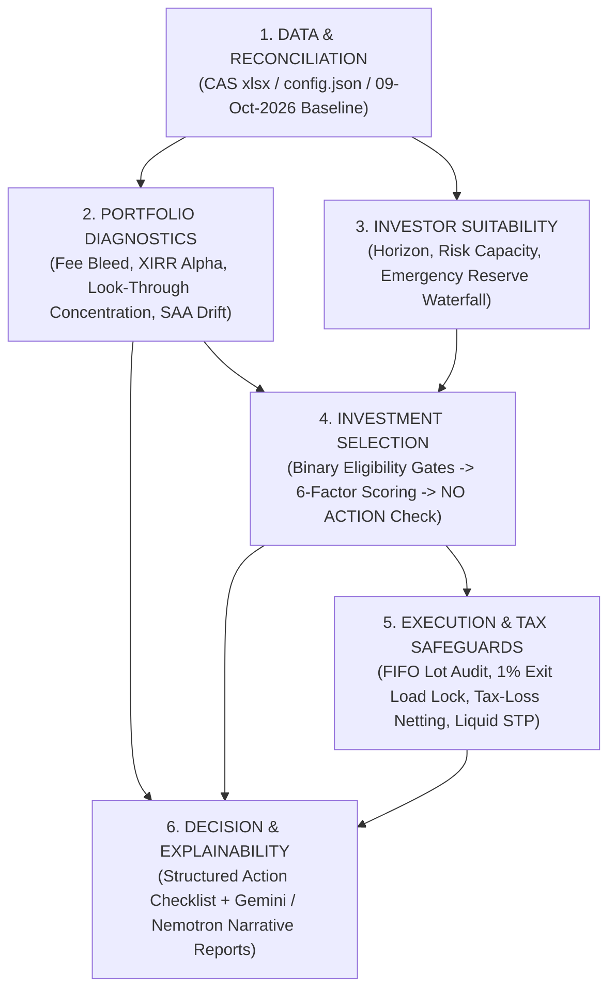

## ⚠️ **ARCHITECTURAL CORRECTIONS - 2024-11-01**

### **6-MODULE ARCHITECTURE IMPLEMENTED**

Replacing 12-engine sprawl with clean 6-module architecture.

**The 6-Module Architecture:**

1. **DATA & RECONCILIATION** - Ingestion, mapping, reconciliation
2. **PORTFOLIO DIAGNOSTICS** - Fee bleed, XIRR, alpha, overlap
3. **INVESTOR SUITABILITY** - Goals, horizon, risk capacity
4. **INVESTMENT SELECTION** - Eligibility gates, scoring
5. **EXECUTION & TAX SAFEGUARDS** - FIFO, exit loads, tax harvesting
6. **DECISION & EXPLAINABILITY** - AI reporting layer

### **MATHEMATICAL CORRECTIONS**

**Overlap Calculation:**
- ❌ OLD: Jaccard similarity only
- ✅ NEW: Weighted look-through concentration

**Risk Scoring:**
- ❌ OLD: Cardinal 5.84/6.00
- ✅ NEW: Ordinal distribution + metrics

**SAA Drift:**
- ❌ OLD: Called "optimizer"
- ✅ NEW: "Drift Minimizer" (accurate description)

**Switch Costs:**
- ❌ OLD: Zero-friction claim
- ✅ NEW: Actual tax + exit load calculation

**Multi-Cap Funds:**
- ❌ OLD: Dogmatic exit
- ✅ NEW: Evaluate on actual merits

**Eligibility:**
- ✅ NEW: Mandatory binary gates before scoring

**NO ACTION:**
- ✅ NEW: Mandatory decision branch

---

# Option B — High‑Level Design (HLD) & Low‑Level Design (LLD)
## Version 2.0 (Max‑Optimized Fiduciary Specification)

> **Companion to OPTION_B_ROADMAP.md and logical_flow.md.**  
> Describes the 6‑Module unified architecture, rigorous look‑through mathematical formulas, binary eligibility gates, tax execution realities, and the mandatory **NO ACTION** fiduciary branch.

---

## 1. High‑Level Design (HLD)

### 1.1 Core Fiduciary Principles
1. **Deterministic Calculations First:** Every number (XIRR, fee bleed, look-through concentration, capital gains tax, exit load, SAA drift) is calculated by pure Python before any AI is called. Zero LLM math.
2. **Immutable Local Financial Data:** Ground truth is strictly rooted in verified statement data (`cas_detailed_report_*.xlsx`), canonical policies, and audited historical transactions.
3. **Pydantic V2 Validated Contracts:** Structured payloads pass through strict type and range validations.
4. **LLM Restricted to Narrative Interpretation:** The AI receives verified facts, applicable policies, and deterministic decisions; it translates them into plain English without altering figures.
5. **The Mandatory "NO ACTION" Rule:** If no candidate scheme offers a demonstrable, statistically validated improvement over existing holdings, the engine's explicit verdict is **NO ACTION / HOLD**.

---

### 1.2 The 6‑Module Architecture

Instead of an unmanageable sprawl of ad-hoc engines, Option B is organized into **six logically separated, single-responsibility modules**:

```
┌────────────────────────────────────────────────────────────────────────┐
│                        THE 6-MODULE ARCHITECTURE                       │
├──────────────────────────────────┬─────────────────────────────────────┤
│ 1. DATA & RECONCILIATION         │ Ingestion, canonical mapping, date  │
│                                  │ reconciliation, data quality gates. │
├──────────────────────────────────┼─────────────────────────────────────┤
│ 2. PORTFOLIO DIAGNOSTICS         │ Fee bleed, XIRR, benchmark alpha,   │
│                                  │ look-through overlap, SAA drift.    │
├──────────────────────────────────┼─────────────────────────────────────┤
│ 3. INVESTOR SUITABILITY          │ Goals, horizon, liquidity, risk     │
│                                  │ capacity vs tolerance, emergency FD.│
├──────────────────────────────────┼─────────────────────────────────────┤
│ 4. INVESTMENT SELECTION          │ Mandatory eligibility gates, 6-factor│
│                                  │ scoring, valuation, NO ACTION branch│
├──────────────────────────────────┼─────────────────────────────────────┤
│ 5. EXECUTION & TAX SAFEGUARDS    │ FIFO lot audit, exit loads, tax loss│
│                                  │ harvesting, 6-mo liquid STP.        │
├──────────────────────────────────┼─────────────────────────────────────┤
│ 6. DECISION & EXPLAINABILITY     │ Approve / Reject / Hold / Defer,    │
│    (AI Reporting Layer)          │ verified facts only, zero AI math.  │
└──────────────────────────────────┴─────────────────────────────────────┘
```

---

### 1.3 End-to-End Pipeline



---

## 2. Low‑Level Design (LLD) & Mathematical Specifications

### Module 1: Data & Reconciliation
* **Input Schema:** `config.json` (IPS), `fund_metrics.json`, `fund_aliases.json`, `transactions.json`, `cas_detailed_report_*.xlsx`.
* **Date Reconciliation Gate:** All holdings, valuations, and tax lots must reconcile to a single immutable snapshot date (Default: `09-Oct-2026`). Never silently mix dates across statements.

---

### Module 2: Portfolio Diagnostics

#### 2.1 Fee Bleed & Illustrative Opportunity Loss
* **Annual Recoverable Bleed (Exact):**
  $$\text{Annual Bleed (₹)} = \sum_{i \in \text{Regular}} \text{Current Value}_i \times \left(\frac{\text{TER}_{\text{regular}, i} - \text{TER}_{\text{direct}, i}}{100}\right)$$
* **10-Year Illustrative Compounded Scenario:**
  $$\text{Compounded Scenario (₹)} = \text{Annual Bleed} \times \left[\frac{(1 + r)^{10} - 1}{r}\right] \quad (r = 12.0\% \text{ assumed})$$
  *(Note: Must be explicitly tagged as an illustrative compounding projection, not a guaranteed wealth forecast).*

#### 2.2 Look-Through Concentration vs Naive Jaccard
Naive Jaccard ($\frac{|A \cap B|}{|A \cup B|}$) measures shared stock count without regard to position sizing. Option B implements **Look-Through Weighted Concentration**:
* **Look-Through Stock Weight ($W_{S_k}$):** For any underlying security $S_k$ held across $M$ funds:
  $$W_{S_k} = \sum_{i=1}^{M} \left( \frac{\text{Value of Fund } i}{\text{Total Portfolio Value}} \times \text{Weight of } S_k \text{ in Fund } i \right)$$
* **Portfolio Concentration Metric:** Top-10 aggregate look-through stock exposure and sector exposure across all 23 folios.

#### 2.3 SAA Drift Minimizer (Not an "Optimizer")
The fresh cash allocator is formally defined as an **SAA Drift Minimizer**:
$$\min_{\vec{S}} \sum_{j \in \{\text{Large, Mid, Debt}\}} \left[ \text{Target}_j - \frac{\text{Current}_j + S_j}{\text{Total} + \sum S_k} \right]^2$$
$$\text{subject to } \sum S_k = \text{Budget}, \quad S_k \ge 0$$

---

### Module 3: Investor Suitability & Liquidity Waterfall

#### 3.1 Emergency Reserve vs Deployable Cash
* **Configurable Emergency Buffer:**
  $$\text{Mandatory Reserve} = \text{Monthly Living Expenses} \times K \quad (K \in [3, 6] \text{ months, default } 6)$$
* **Deployable Capital:**
  $$\text{Deployable Surplus} = \max(0, \text{Bank Cash} - \text{Mandatory Reserve})$$
  *Bank cash is never treated as automatically investable without passing through this liquidity gate.*

#### 3.2 Cardinal vs. Ordinal Risk Representation
* SEBI Risk-o-meter tiers (Low to Very High) are **ordinal product labels**, not cardinal statistical scores.
* The system reports:
  1. Percentage distribution across SEBI risk tiers (e.g. 84.2% Tier 6, 15.8% Tier 5, 0.0% Tiers 1–4).
  2. Statistical risk parameters: Portfolio Beta ($\beta = 1.02$), Jensen's Alpha ($\alpha = +3.82\%$), and Maximum Drawdown tolerance in hard rupees.

---

### Module 4: Investment Selection & The "NO ACTION" Engine

#### 4.1 Mandatory Binary Eligibility Gates
Before any fund is evaluated for candidate scoring, it must pass all 4 binary gates:
1. **Data Integrity Gate:** Complete NAV history $\ge 3$ years and verified benchmark assignment.
2. **Liquidity Gate:** Fund AUM $\ge ₹1,000\text{ Crores}$ (prevents micro-fund redemption runs).
3. **Concentration Gate:** Top-10 stock concentration $\le 55\%$ (eliminates unhedged momentum bets).
4. **Mandate Suitability Gate:** Pure unconstrained mandate (Flexi-Cap, Mid-Cap, or Short-Term Debt; single-sector thematics capped at client IPS policy limits).

#### 4.2 Fiduciary Candidate Scoring (0 to 100)
Eligible funds are scored across multi-cycle metrics:
* Direct Plan TER (20% weight)
* 3Y & 5Y Rolling Jensen's Alpha (25% weight)
* Downside Capture & Beta $< 1.0$ (20% weight)
* Asset Breadth & Portfolio Stock Count (15% weight)
* Downside Buffer / Cash / International Exposure (10% weight)
* AMC Track Record & Management Stability (10% weight)

#### 4.3 The "NO ACTION" Branch
$$\text{If } \max_{c \in \text{Candidates}} \text{Score}(c) \le \text{Score}(\text{Existing}) + \Delta_{\text{threshold}} \implies \mathbf{VERDICT: \text{NO ACTION / HOLD}}$$
*Prevents portfolio churn and commission-generating switches that do not offer statistically significant structural improvement.*

---

### Module 5: Execution & Tax Safeguards

#### 5.1 Tax Reality of Mutual Fund Switches
* Under **Sections 47 and 112A of the Income Tax Act**, a switch is legally a **redemption followed by a purchase**.
* Same-AMC switches are **taxable events** and subject to AMC exit loads. "Zero-friction" claims are explicitly prohibited.

#### 5.2 FIFO Lot-Level Staging Rules
* **Tranche 1 (Immediate / Month 1):** Switch only lots $> 365\text{ days}$ old that carry unrealized capital losses or net gains within the annual ₹1.25 Lakh exemption limit.
* **Tranche 2 (Months 2–11):** Lock immature lots ($\le 365\text{ days}$) in place until day 366 to avoid 1% exit loads and 20% STCG.
* **Tranche 3 (Next Financial Year - April 1):** Stagger remaining mature gains into the next financial year's fresh ₹1.25 Lakh tax-free exemption.

---

### Module 6: Decision & Reporting Layer (LLM Contract)
* **LLM Input:** Strict JSON fact payload generated by Modules 1–5.
* **LLM Contract:**
  1. The LLM receives pre-computed tables, scores, and verdicts.
  2. The LLM is strictly prohibited from performing independent financial math.
  3. All narrative explanations must reference statutory sections (Sec 112A, Sec 47) and exact rupee figures from the payload.

---

## 3. Capability Status Matrix

| Capability | Status | Implementation Reference |
| :--- | :---: | :--- |
| **CAS xlsx Normalization & Ingestion** | ✅ Verified | `advisor_lean.py:74-89`, `ingestion/` |
| **Fee Bleed Calculation (Annual & 10Y)** | ✅ Verified | `advisor_lean.py:90-94`, `core/math_engine.py` |
| **Unified XIRR & Benchmark Alpha (+3.82%)** | ✅ Verified | `core/math_engine.py:portfolio_xirr` |
| **FIFO Tax-Loss Harvesting Offset** | ✅ Verified | `advisor_lean.py:215-251`, `outputs/MFCentral_Action_Checklist.csv` |
| **SAA Drift Minimizer (Dynamic 6-Tier)** | ✅ Verified | `advisor_lean.py:170-196`, `advisor_lean.py:490-577` |
| **Reverse Fed Model & Liquid STP** | ✅ Verified | `core/candidate_scoring.py`, `advisor_lean.py:580-670` |
| **Look-Through Weighted Concentration** | 🟡 Sprint 1 Expand | To replace naive Jaccard top-10 in next iteration |
| **Binary Eligibility Gates & NO ACTION** | 🟡 Sprint 3 Add | Formally codified in `OPTION_B_HLD_LLD.md` v2.0 |
| **Automated CAMS/KFin PDF Parser** | 🔵 Future Phase | Scheduled for Option A Enterprise Migration |

---
*End of HLD/LLD v2.0*
