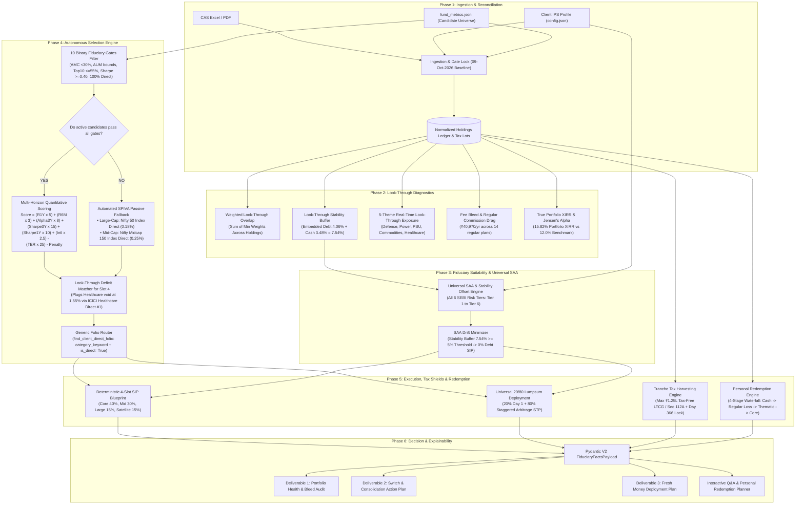

# Master Fiduciary Wealth Engine — Logical Flow & Architecture (v2.5)

## 1. System Pipeline Overview



---

## 2. The 5 Universal Mathematical Invariants

### 2.1 Invariant 1: Universal 20/80 Lumpsum Deployment Equation
Neutralizes market-timing anxiety and sequence-of-returns risk across all ticket sizes:

$$\text{Day 1 Immediate Core Equity Anchor} = 0.20 \times L$$
$$\text{Tax-Shielded Arbitrage Parking Pool} = 0.80 \times L$$
$$\text{Monthly Systematic Transfer (STP)} = \frac{0.80 \times L}{M}$$

Where $M$ is the dynamic staggering duration:
- $L \le \text{₹5 Lakhs} \implies M = 6 \text{ Months}$
- $\text{₹5 Lakhs} < L \le \text{₹10 Lakhs} \implies M = 9 \text{ Months}$
- $\text{₹10 Lakhs} < L \le \text{₹25 Lakhs} \implies M = 12 \text{ Months}$
- $L > \text{₹25 Lakhs} \implies M = 18 \text{ Months}$

* **Section 50AA Tax Arbitrage:**
  Under Section 50AA of the Income Tax Act, pure debt mutual funds are taxed at the investor's **marginal slab rate (up to 39.0%)**. The engine parks parking capital exclusively in **Equity Arbitrage Funds - Direct Plan** (~6.8% annualized yield). Arbitrage funds qualify for equity taxation under Sections 111A/112A (12.5% LTCG, 20% STCG). On a ₹50 Lakh deployment, this preserves **₹15,232.00** in statutory tax savings.
* **Multi-Slot SAA Preservation:**
  For big-ticket deployments ($L \ge \text{₹5 Lakhs}$), the 80% STP systematically distributes across 3 core growth engines:
  - Flexi-Cap Compounder: $50\%$ of STP pool ($40\%$ of total lumpsum)
  - Mid-Cap Alpha Engine: $35\%$ of STP pool ($28\%$ of total lumpsum)
  - Large-Cap Bluechip Anchor: $15\%$ of STP pool ($12\%$ of total lumpsum)

### 2.2 Invariant 2: Universal 4-Slot Sizing Engine (40/30/15/15)
To prevent folio proliferation and micro-fragmentation, all fresh monthly SIP capital compounds across 4 distinct sleeves:
1. **Slot 1: Core Flexi-Cap Compounder (40%)**
   - Industry-lowest direct expense ratio, international technology currency ballast, and defensive cash buffers.
2. **Slot 2: Mid-Cap Alpha Engine (30%)**
   - High-conviction mid-cap alpha generator with strict AUM bounds ($\le$ ₹40,000 Cr liquidity ceiling).
3. **Slot 3: Large-Cap Bluechip Anchor (15%)**
   - Consolidates active direct large-cap folios, or defaults to low-cost Nifty 50 Index Direct (0.18% TER) under the SPIVA rule.
4. **Slot 4: Tactical Thematic Satellite (15% Max)**
   - Resolves largest verified look-through deficit at reasonable valuations (Healthcare at 1.55%).
   - *Starter Rule:* Hard-capped at 0.0% for portfolios < ₹5L AUM to avoid micro-fragmentation (split 60% Flexi / 40% Mid-Cap).

### 2.3 Invariant 3: Universal Tax Shield Siphon (Section 112A)
Switches are treated as taxable redemptions under Sections 47 & 112A of the Income Tax Act:
* **Annual Exemption Siphon:** Harvests up to **₹1,25,000 LTCG tax-free** per financial year.
* **Day 366 Exit Load Rule:** Immature lots (<365 days) are strictly locked until Day 366 to eliminate 1.0% exit load penalties and 20% STCG.

### 2.4 Invariant 4: Universal Personal Redemption Engine (4-Stage Waterfall)
When an investor requires liquidity, redemptions follow a disciplined 4-stage tax-minimizing waterfall:
1. **Stage 1 (Organic Cash):** Bank surplus above the emergency reserve (₹0 tax, ₹0 exit load).
2. **Stage 2 (Tactical Regular Bleed):** Underperforming Regular plans with capital losses (loss-harvesting under Section 70) or mature LTCG within the ₹1.25L exemption (₹0 exit load).
3. **Stage 3 (Thematic Trim):** Over-allocated, bubble-valuation thematic funds (Defence, Energy).
4. **Stage 4 (Core Equity Siphon):** Core long-term Direct equity holdings held >365 days.
* **Modes:** Supports **Gross Redemption** (gross withdrawal) and **Net Payout** (grosses up capital to cover statutory tax liabilities).

### 2.5 Invariant 5: Universal SAA & Look-Through Stability Offset Engine
Governs asset allocation across all 6 SEBI Regulatory Risk Tiers:
$$\text{Stability Buffer } (S) = \frac{\sum (V_i \times (\text{DebtPct}_i + \text{CashPct}_i))}{\text{Total Portfolio Value}} \times 100$$
$$\text{Threshold}(T) = \max\bigl(0.0,\; D_{\text{target}}(T) - \text{Tolerance}(T)\bigr)$$

$$\text{Final Debt SIP \%} = \begin{cases} 
0.0\% & \text{if } S \ge \text{Threshold}(T) \quad (\text{Stability Cushion Organically Satisfied}) \\
D_{\text{base}}(T) & \text{if } S < \text{Threshold}(T) \quad (\text{Deficit Funded via Stability Vehicle})
\end{cases}$$

- **Lalit's Stability Buffer:** $7.54\% = 4.06\% \text{ Debt} + 3.48\% \text{ Cash}$.
- **Tier 6 Threshold:** $0.0\% \implies 7.54\% \ge 0.0\% \implies \mathbf{100\% \text{ Equity} / 0\% \text{ Debt}}$.
- **Tier 5 Threshold:** $10.0\% - 5.0\% = 5.0\% \implies 7.54\% \ge 5.0\% \implies \mathbf{100\% \text{ Equity} / 0\% \text{ Debt}}$.
- **Result:** Lalit requires 0% standalone debt SIP in both Tier 6 and Tier 5. Zero low-yield debt drag.

---

## 3. Autonomous Selection Engine & Fiduciary Gate Logic

No fund enters scoring unless it passes all 10 binary gates:
```
Gate 1: Single-AMC net worth exposure <= 30.0%
Gate 2: Mid-Cap AUM <= ₹40,000 Cr | Flexi-Cap AUM <= ₹1,75,000 Cr (with >=65% Large-Cap/Cash, else ₹90k Cr)
Gate 3: Top-10 stock concentration <= 55.0% (Debt and dedicated thematic funds exempted)
Gate 4: 3-Year Sharpe Ratio >= 0.40 (Index and Debt funds adjusted)
Gate 5: Downside Capture Ratio <= 100.0%
Gate 6: Upside Capture Ratio >= 90.0%
Gate 7: Riskometer score <= client SEBI risk tier
Gate 8: Manager tenure >= 3 years & complete track record
Gate 9: Thematic satellite cap <= 15% (0% for < ₹5L AUM)
Gate 10: 100% Direct Plan mandate (Zero Regular plans)
```

### 3.1 Multi-Horizon Quantitative Composite Scoring
$$\begin{aligned}
\text{Score} =\;& (R_{1\text{Y}} \times 5.0) + (R_{6\text{M}} \times 3.0) + (\text{Alpha}_{3\text{Y}} \times 8.0) \\
&+\; (\text{Sharpe}_{3\text{Y}} \times 15.0) + (\text{Sharpe}_{1\text{Y}} \times 10.0) \\
&+\; (\text{Intl\%} \times 2.5) + (\text{CashBuf\%} \times 1.0) \\
&-\; (\text{TER}_{\text{Direct}} \times 25.0) - \text{Concentration Penalty}
\end{aligned}$$

### 3.2 Peer Evaluation: Healthcare / Pharma Slot 4 Ranking
| Scheme Name (100% Direct Plans) | 1-Year Return | 6-Month Return | 3-Year CAGR | 3-Year Sharpe | Direct TER | Multi-Horizon Score | Fiduciary Decision |
|---|:---:|:---:|:---:|:---:|:---:|:---:|---|
| **ICICI Prudential Healthcare Direct** | **49.4%** | **16.2%** | **24.1%** | **1.02** | **0.89%** | **360.1** | 🏆 **SELECTED (Rank #1)** |
| **Mirae Asset Healthcare Direct** | 40.2% | 14.5% | 22.5% | 0.94 | 0.62% | 308.2 | 🥈 **RUNNER-UP** |
| **Tata India Pharma & Healthcare Direct** | 41.5% | 15.0% | 19.8% | 0.85 | 0.76% | 287.8 | ❌ **REJECTED** |
| **Nippon India Pharma / Healthcare Direct** | **35.2%** | **12.8%** | **18.7%** | **0.78** | **0.99%** | **231.6** | ❌ **REJECTED (Rank #4)** |

### 3.3 SPIVA Automated Passive Fallback
If active funds in a category fail the gates (e.g. all active large-caps failing Gate 4 Sharpe $\ge 0.40$), the system automatically routes to:
- **Large-Cap Anchor:** Nifty 50 Index Fund Direct (0.18% TER)
- **Mid-Cap Alpha:** Nifty Midcap 150 Index Fund Direct (0.25% TER)

### 3.4 Generic Folio Routing
Folio reuse is executed by `find_client_direct_folio(holdings, category_keyword)`:
$$\text{Investor Holdings} \xrightarrow{\text{Category Keyword Match } + \text{ is\_direct=True}} \text{Target Direct Folio}$$
Eliminating all hardcoded AMC brand names.

---

## 4. Verification Evidence & Scorecard

- **Pytest Suite (`test_p0_fiduciary_invariants.py`):** 6/6 Tests PASSED (Exit Code: 0).
- **Validation Suite (`validate_final_logics.py`):** 83/83 Checks PASSED (100% Success Rate).
- **Deliverables Generation (`advisor.py`):** Successfully generates all 3 deliverables in `outputs/` (.md + .pdf) with 100% grounded facts.
