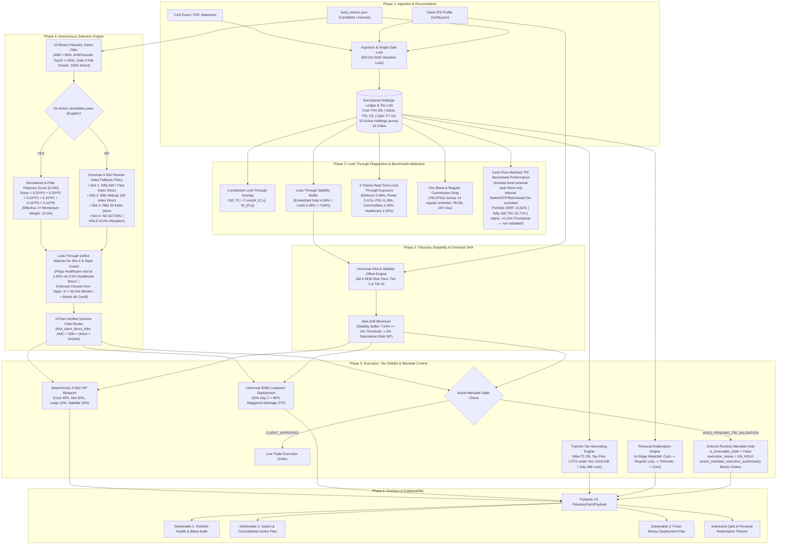

# Master Fiduciary Wealth Engine — Logical Flow & Architecture (v3.2)

## 1. System Pipeline Overview

---

> [!IMPORTANT]
> ### ⚖️ Fiduciary Invariant: Zero Hardcoding & Zero Fabrication Mandate
> In financial engines, fabricating metrics or hardcoding fund brand names is strictly prohibited. If candidate schemes or metrics cannot be dynamically evaluated from verified data (`fund_metrics.json`, CAS statements), the engine MUST fail safely (e.g. raise an exception or output an auditable **NO ACTION / HOLD** decision) rather than injecting mock figures.
> $$\mathbf{\text{Explicit Safe Failure}} \gg \mathbf{\text{Fabricated / Hardcoded Fallbacks}}$$

---

## 2. The 5 Universal Mathematical Invariants

### 2.1 Invariant 1: Universal 20/80 Lumpsum Deployment Equation
Neutralizes market-timing anxiety and sequence-of-returns risk across all ticket sizes:

$$\text{Day 1 Immediate Core Equity Anchor} = 0.20 \times L$$
$$\text{Tax-Shielded Arbitrage Parking Pool} = 0.80 \times L$$
$$\text{Monthly Systematic Transfer (STP)} = \frac{0.80 \times L}{M}$$

Where $M$ is the dynamic staggering duration:
- $L \le \text{₹5 Lakhs} \implies M = 6 \text{ Months}$
- $\text{₹5 Lakhs} < L \le \text{₹10 Lakhs} \implies M = 9 \text{ Months}$
- $\text{₹10 Lakhs} < L \le \text{₹25 Lakhs} \implies M = 12 \text{ Months}$
- $L > \text{₹25 Lakhs} \implies M = 18 \text{ Months}$

* **Section 50AA / Section 76 Tax Arbitrage:**
  Under Section 50AA (1961 Act) and Section 76 (2025 Act), pure debt mutual funds are taxed at the investor's **marginal slab rate (up to 39.0%)**. Capital is parked exclusively in **Equity Arbitrage Funds - Direct Plan** (holding $> 65.0\%$ domestic equity). Arbitrage funds qualify for equity taxation under Section 198/196 (2025 Act) or Section 112A/111A (1961 Act). On a ₹50 Lakh deployment, this preserves **₹15,232.00** in statutory tax savings.
* **Multi-Slot SAA Preservation:**
  For big-ticket deployments ($L \ge \text{₹5 Lakhs}$), the 80% STP systematically distributes across 3 core growth engines:
  - Flexi-Cap Compounder: $50\%$ of STP pool ($40\%$ of total lumpsum)
  - Mid-Cap Alpha Engine: $35\%$ of STP pool ($28\%$ of total lumpsum)
  - Large-Cap Bluechip Anchor: $15\%$ of STP pool ($12\%$ of total lumpsum)

### 2.2 Invariant 2: Universal 4-Slot Sizing Engine (26.3/52.6/21.1/0)
To prevent folio proliferation and micro-fragmentation, all fresh monthly SIP capital compounds across 4 distinct sleeves:
1. **Slot 1: Core Flexi-Cap Compounder (40%)**
   - Industry-lowest direct expense ratio, international technology currency ballast, and defensive cash buffers.
2. **Slot 2: Mid-Cap Alpha Engine (30%)**
   - High-conviction mid-cap alpha generator with strict AUM bounds ($\le$ ₹40,000 Cr liquidity ceiling).
3. **Slot 3: Large-Cap Bluechip Anchor (15%)**
   - Consolidates active direct large-cap folios, or defaults to low-cost Nifty 50 Index Direct (0.18% TER) under the passive fallback rule.
4. **Slot 4: Tactical Thematic Satellite (15% Max)**
   - Resolves largest verified look-through deficit at reasonable valuations (Healthcare at 1.55%).
   - *Starter Rule:* Hard-capped at 0.0% for portfolios < ₹5L AUM to avoid micro-fragmentation (split 60% Flexi / 40% Mid-Cap).

### 2.3 Invariant 3: Universal Tax Shield Siphon (Section 112A / Section 198)
Switches between Regular and Direct plans are legally transfers under Section 2(47) and taxable under Sections 45 & 112A (1961 Act) or Section 198 (2025 Act):
* **Annual Exemption Siphon:** Harvests up to **₹1,25,000 LTCG tax-free** per financial year across the portfolio.
* **Day 366 Exit Load Rule:** Immature lots (<365 days) are strictly locked until Day 366 to eliminate 1.0% exit load penalties and 20% STCG.

### 2.4 Invariant 4: Universal Personal Redemption Engine (4-Stage Waterfall)
1. **Stage 1 (Cash Siphon):** Liquidates idle bank cash above the client's emergency reserve (₹0 tax, ₹0 exit load).
2. **Stage 2 (Tactical Regular Bleed):** Sweeps underperforming Regular funds carrying commissions, harvesting capital losses under Section 70/108 or mature LTCG within the ₹1.25L exemption.
3. **Stage 3 (Thematic Derisking):** Trims overheated, over-allocated thematic positions (Defence, Energy) at cycle peaks.
4. **Stage 4 (Core Equity Siphon):** Redeems mature core Direct compounders held >365 days (concessional LTCG).
* **Modes:** Supports both **Gross Mode** (fixed gross units) and **Net Mode** (grosses up capital to pay all taxes and exit loads).

### 2.5 Invariant 5: Universal SAA & Stability Offset Engine
$$\text{Stability Buffer } (S) = \frac{\sum (V_i \times (\text{DebtPct}_i + \text{CashPct}_i))}{\text{Total Portfolio Value}} \times 100$$
$$\text{Threshold}(T) = \max\bigl(0.0,\; D_{\text{target}}(T) - \text{Tolerance}(T)\bigr)$$

$$\text{Final Debt SIP \%} = \begin{cases} 
0.0\% & \text{if } S \ge \text{Threshold}(T) \quad (\text{Stability Cushion Organically Satisfied}) \\
D_{\text{base}}(T) & \text{if } S < \text{Threshold}(T) \quad (\text{Deficit Funded via Stability Vehicle})
\end{cases}$$

For Lalit ($S = 7.54\%$):
- **Tier 6 (Very High):** $7.54\% \ge 0.0\% \implies \mathbf{100\% \text{ Equity} / 0\% \text{ Debt}}$.
- **Tier 5 (High):** $7.54\% \ge 5.0\% \implies \mathbf{100\% \text{ Equity} / 0\% \text{ Debt SIP}}$. Eliminates pure debt drag completely.

---

## 3. Thematic Taper Exact Closed-Form Algebra

$$\frac{V_{\text{existing}, H} + S_H \cdot m}{V_{\text{current}} + S_{\text{total}} \cdot m} = \text{Ceiling}$$

* $V_{\text{current}} = \text{₹}51,70,911.38$
* $V_{\text{existing}, H} = \text{₹}80,396.14$ ($1.5547\%$ look-through healthcare)
* $S_{\text{total}} = \text{₹}1,00,000/\text{month}$
* $S_H = \text{₹}14,250/\text{month}$ ($15\% \times 95\%$ underlying equity)
* $\text{Ceiling} = 7.50\% = 0.075$ (Benchmark 5.50% + Tactical Tolerance 2.00%)

$$m = \frac{(0.075 \times 5,170,911.38) - 80,396.14}{14,250 - (0.075 \times 100,000)} = \frac{307,422.2135}{6,750} = \mathbf{45.5440\text{ months}}$$

* **Month 39:** $7.013\% < 7.50\%$ (Safe)
* **Month 40:** $7.092\% < 7.50\%$ (Safe)
* **Month 45:** $7.462\% < 7.50\%$ (Final Safe Month)
* **Month 46:** $7.532\% \ge 7.50\%$ (**Breaches Ceiling $\rightarrow$ Automatic Taper to 0.0% Triggered**)

---

## 4. Candidate Look-Through Overlap & Four-Slot Fallback

### 4.1 Constituent Look-Through Overlap
$$\text{Overlap}(C, P) = \sum_{s \in C \cap P} \min(W_{C, s},\; W_{P, s})$$
* ICICI Pru Healthcare Direct: **0.78%**
* Mirae Asset Healthcare Direct: **0.93%**
* Tata India Pharma Direct: **0.00%**
* Nippon India Pharma Direct: **0.93%**

### 4.2 Fallback Architecture
* **Slot 1 (Flexi-Cap):** Active rank #1 $\rightarrow$ Nifty 500 / Flexi Index Direct $\rightarrow$ NO ACTION / HOLD
* **Slot 2 (Mid-Cap):** Active rank #1 $\rightarrow$ Nifty Midcap 150 Index Direct $\rightarrow$ NO ACTION / HOLD
* **Slot 3 (Large-Cap):** Direct folio reuse $\rightarrow$ Active rank #1 $\rightarrow$ Nifty 50 Index Direct $\rightarrow$ NO ACTION / HOLD
* **Slot 4 (Thematic Satellite):** Active rank #1 under 7.5% ceiling $\rightarrow$ strictly collapses to 0.0% (**NO ACTION / HOLD**).
