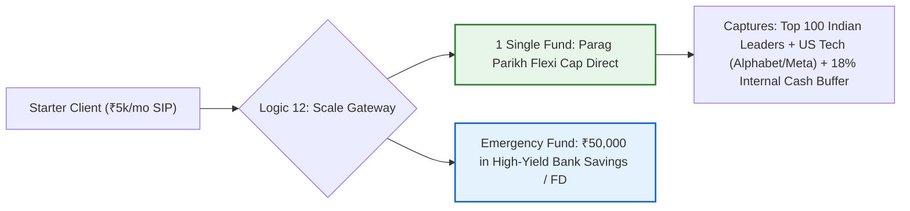
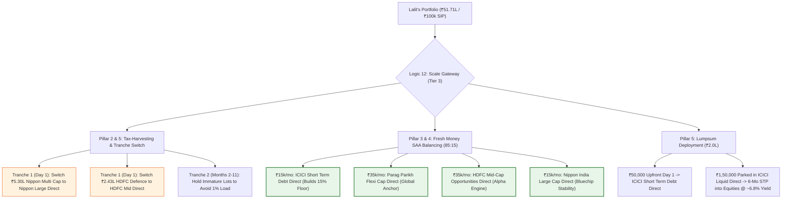

# Universal Fiduciary Wealth Engine — Logical Flow Architecture

> **Comprehensive Architecture & Logic Mapping Document**  
> *Defines how all 12 core engines bind together, how the framework dynamically adapts across investor wealth tiers (Starter vs. Established), and the mathematical flow from raw statement ingestion to execution.*

---

## 1. Executive Summary & The Investor Scale Paradox

### 1.1 The Problem: One Size Does NOT Fit All
A frequent failure of financial advisory software is applying a complex, multi-sleeve institutional architecture to a beginner investor, or conversely, giving an oversimplified single-index fund to a ₹50+ Lakh portfolio burdened with legacy tax lots and high commission drag.

* **A Starter Investor (e.g., ₹5,000/month SIP, Net Worth < ₹5 Lakhs):**
  * Cannot and should not hold a 4-to-5 fund portfolio with a dedicated mutual fund debt floor. 
  * Their fixed-income cushion belongs in an emergency bank savings/FD account, not in short-term debt mutual funds.
  * Splitting ₹5,000 across 4 funds creates micro-allocations (₹750 to ₹1,500) that generate needless paperwork, rebalancing friction, and zero tangible risk reduction.
* **An Established Investor (e.g., Lalit Saini, ₹51.71 Lakhs, 23 Funds, ₹1 Lakh/month SIP):**
  * Suffers from real structural traps: ₹39,020/year in commission bleed, 3 overlapping multi-caps, ₹1.58 Lakhs in volatile single-sector defence profits, and a 5.84/6.00 unhedged risk score.
  * Requires lot-level FIFO tax-loss harvesting, thematic exit staging, and an intentional fixed-income floor to prevent capitulation during 20%–35% drawdowns.

### 1.2 The 3-Tier Investor Scale Matrix

```
┌────────────────────────────────────────────────────────────────────────────────────────┐
│                                 THE INVESTOR SCALE MATRIX                              │
├───────────────────────┬──────────────────────────────┬─────────────────────────────────┤
│ Tier 1: Starter       │ Tier 2: Builder              │ Tier 3: Established / Fiduciary │
│ (Net Worth < ₹5L /    │ (Net Worth ₹5L – ₹25L /      │ (Net Worth > ₹25L /             │
│  SIP < ₹10k/mo)       │  SIP ₹10k – ₹30k/mo)         │  SIP > ₹30k/mo — e.g. Lalit)    │
├───────────────────────┼──────────────────────────────┼─────────────────────────────────┤
│ • 1 to 2 Funds Max    │ • 3 Funds Max                │ • 4 to 5 Funds Institutional    │
│ • 100% Core Flexi-Cap │ • Core Flexi (50%)           │ • Core Flexi Compounder (35%)   │
│   (or Nifty 50 Index) │ • Mid-Cap Alpha (35%)        │ • Mid-Cap Alpha Engine (35%)    │
│ • Debt Floor: Bank FD │ • Large-Cap Anchor (15%)     │ • Large-Cap Bluechip (15%)      │
│ • Zero tax harvesting │ • Debt: Bank Cash + Liquid   │ • AAA Short-Term Debt (15%)     │
│   needed (under ₹1.25L│ • Annual rebalancing         │ • Lot-Level FIFO Tax Harvesting │
│   exemption limit).   │   via fresh cash flows.      │ • Reverse Fed Valuation STP     │
└───────────────────────┴──────────────────────────────┴─────────────────────────────────┘
```

---

## 2. Master System Logical Flowchart

This master diagram maps how raw client input passes through all **12 Named Fiduciary Engines** to produce the final executable outputs.

```mermaid
flowchart TD
    subgraph INGESTION ["Phase 1: Ingestion & Reconciliation"]
        A["Client Statement (CAS Excel / PDF / CAMS / KFin)"] --> L1["Logic 1: CAS Parser & Normalizer"]
        B["Client IPS (Age, Goals, Risk Tolerance, Budget)"] --> L1
        L1 --> D1[("Clean Holdings Ledger & Tax Lots")]
    end

    subgraph DIAGNOSTIC ["Phase 2: Diagnostic & Forensic Audit"]
        D1 --> L2["Logic 2: Fee Bleed & Friction Engine"]
        D1 --> L3["Logic 3: Holdings & Overlap Matrix"]
        D1 --> L4["Logic 4: SEBI Categorization & Structural Rules"]
        D1 --> L6["Logic 6: Unified XIRR & Benchmark Alpha"]
        D1 --> L8["Logic 8: SEBI Scheme Risk-o-meter Engine"]
        
        L2 --> R1["Audit Output: ₹39k/yr Bleed Identified"]
        L3 --> R2["Audit Output: 23.3% Multi-Cap Crowding"]
        L4 --> R3["Audit Output: Multi-Cap 25/25/25 & Thematic Traps"]
        L6 --> R4["Audit Output: 15.82% XIRR vs 12.0% Bench (+3.82% Alpha)"]
        L8 --> R5["Audit Output: Weighted Risk Score 5.84 / 6.00"]
    end

    subgraph ADAPTATION ["Phase 3: Investor Scale & Suitability Gateway"]
        D1 & B --> L12["Logic 12: Tiered Investor Adaptation Logic"]
        L12 -->|Net Worth < ₹5L| TIER1["Tier 1: Starter Pipeline (1-2 Funds)"]
        L12 -->|₹5L to ₹25L| TIER2["Tier 2: Builder Pipeline (3 Funds)"]
        L12 -->|Net Worth > ₹25L| TIER3["Tier 3: Established Pipeline (4-5 Funds)"]
    end

    subgraph ALLOCATION ["Phase 4: Optimization & Candidate Selection"]
        TIER3 --> L9["Logic 9: SAA Suitability & Cap Drift Engine"]
        TIER3 --> L10["Logic 10: Cash Waterfall & Liquidity Engine"]
        TIER3 --> L11["Logic 11: Market Valuation Engine (Reverse Fed)"]
        
        L9 & L11 --> L7["Logic 7: 6-Factor Fiduciary Candidate Scoring"]
        L7 --> SEL["Institutional Champions Selected:
        • PPFAS Flexi Cap Direct (Score: 80.0)
        • HDFC Mid-Cap Direct (Score: 82.5)
        • Nippon Large Cap Direct (Score: 62.0)
        • ICICI Short Term Debt Direct (Score: 84.0)"]
    end

    subgraph EXECUTION ["Phase 5: Tax-Safe Execution & Action Plan"]
        SEL & D1 --> L5["Logic 5: FIFO Lot-Level Tax & Exit Load Engine"]
        L5 --> EX1["Tranche 1 (Immediate / Month 1):
        Switch Mature Lots with Losses or Gains ≤ ₹1.25L
        Offset HDFC Defence (+₹1.58L) vs Losses (-₹47.2k) = ₹0 Tax"]
        L5 --> EX2["Tranche 2 (Months 2-11):
        Lock Immature Lots (<365d) to avoid 1% Load & 20% STCG"]
        L5 --> EX3["Tranche 3 (Next FY April 1):
        Stagger remaining mature gains into next ₹1.25L exemption"]
        
        L11 & SEL --> EX4["Fresh Money Blueprint:
        • ₹15k/mo Debt Floor (Day 1 Upfront)
        • ₹85k/mo Equity via 6-Mo Liquid STP @ ~6.8%"]
    end

    subgraph DELIVERABLES ["Phase 6: Final Deliverables"]
        EX1 & EX2 & EX3 --> OUT1["MFCentral_Action_Checklist.csv (23 Rows)"]
        R1 & R2 & R3 & R4 & R5 --> OUT2["Portfolio_Health_Audit.pdf"]
        EX1 & EX2 & EX3 --> OUT3["Switch_and_Consolidation_Plan.pdf"]
        EX4 --> OUT4["Fresh_Money_Deployment_Plan.pdf"]
        DELIVERABLES --> UI["Streamlit Fiduciary Dashboard (Port 8501)"]
    end
```

---

## 3. Comprehensive Catalog of the 12 Named Fiduciary Logics

Below is the exhaustive mathematical and regulatory definition of every engine in the system:

### Logic 1: CAS Parser & Normalizer Engine (`ingestion/cas_parser.py`)
* **Purpose:** Ingests unstructured CAMS/KFintech Consolidated Account Statements (Excel/PDF) and normalizes messy AMC scheme strings.
* **Mathematical Operations:**
  * Regex canonicalization: Strips noisy strings (`"Direct"`, `"Regular"`, `"Growth"`, `"IDCW"`, `"Reinvestment"`, `"Option"`).
  * Jaccard token matching against `fund_aliases.json` to resolve exact ISIN / AMFI codes.
  * Folio aggregation: Groups units across identical folios while preserving distinct folio IDs.

### Logic 2: Fee Bleed & Friction Engine (`FeeBleedCalculator`)
* **Purpose:** Quantifies the exact dead-weight distributor commission drag.
* **Formulas:**
  $$\text{Annual Bleed (₹)} = \sum_{i \in \text{Regular}} \text{Current Value}_i \times \left(\frac{\text{TER}_{\text{regular}, i} - \text{TER}_{\text{direct}, i}}{100}\right)$$
  $$\text{10-Year Opportunity Loss} = \text{Annual Bleed} \times \left[\frac{(1 + r)^n - 1}{r}\right] \quad (r=12\%)$$
* **Lalit's Verified Value:** ₹39,019.54/year recoverable bleed across 14 regular schemes (₹37.64 Lakhs regular value).

### Logic 3: Holdings & Overlap Matrix Engine (`OverlapAnalyzer`)
* **Purpose:** Detects portfolio bloat where multiple funds hold the identical underlying stocks.
* **Mathematical Operations:**
  * Pairwise Jaccard stock similarity:
    $$\text{Overlap}(A, B) = \frac{|H_A \cap H_B|}{|H_A \cup H_B|} \times 100$$
  * Flags any pair with overlap $> 30\%$.
* **Lalit's Verified Value:** 23.3% average overlap across 3 Multi-Cap funds holding the identical 10 stocks (ICICI Bank, HDFC Bank, Infosys, Reliance).

### Logic 4: SEBI Categorization & Structural Rule Engine (Rules D0 to D6)
* **Purpose:** Evaluates whether a fund's legal mandate or concentration creates uncompensated risk.
* **Rules:**
  * **Rule D1 (Multi-Cap Constraint Audit):** Multi-Cap funds carry a mandatory 25% Large / 25% Mid / 25% Small structural rule. Rather than a blanket category ban, the engine audits the fund's look-through concentration, rolling risk-adjusted alpha, and downside capture. If the fund underperforms category benchmarks (e.g. Mirae Multi-Cap alpha -0.61%), it is flagged for consolidation into unconstrained broad-market funds.
  * **Rule D2 (Thematic Allocation Limits):** Thematic/Sectoral exposure is bounded by client-specific IPS policy limits (recommended $\le 10\%$). Holdings trading at extreme historical valuation multiples (e.g., HDFC Defence at 70x+ P/E) are audited for profit harvesting.
  * **Rule D3 (Same-AMC Switch Routing):** Routes regular-to-direct switches into active folios within the identical AMC on MFCentral. *Mandatory Fiduciary Notice: An intra-AMC switch remains legally a taxable redemption followed by a purchase under Sec 47 and Sec 112A, and is subject to AMC exit loads.*
  * **Rule D4 (The Mandatory NO ACTION Rule):** If no candidate fund provides a statistically significant improvement over existing holdings after factoring in tax and exit-load friction, the engine issues a formal verdict of **NO ACTION / HOLD**.

### Logic 5: FIFO Lot-Level Tax & Exit Load Engine (`TaxHarvestingEngine`)
* **Purpose:** Enforces Section 112A and Section 47 of the Indian Income Tax Act. A mutual fund switch is legally treated as a **Redemption followed by a Purchase**.
* **Rules:**
  * **Lot Tagging:** Every purchase lot is audited for holding duration:
    $$\text{Age} = \text{Audit Date} - \text{Purchase Date}$$
  * **Exit Load Guard:** If $\text{Age} \le 365\text{ days}$, tag as `IMMATURE` (1.0% exit load penalty). **Do not switch.**
  * **Tax Guard:**
    * If $\text{Age} \le 365\text{ days}$: Subject to 20% Short-Term Capital Gains (STCG).
    * If $\text{Age} > 365\text{ days}$: Subject to 12.5% Long-Term Capital Gains (LTCG) on gains exceeding the ₹1.25 Lakh annual exemption limit.
  * **Tax-Loss Harvesting Offset:** Net realized capital losses against realized gains:
    $$\text{Taxable Gain} = \max\left(0, \text{Realized Gains} - \text{Realized Losses} - ₹1,25,000\right)$$
  * **Lalit's Result:** Offsets HDFC Defence (+₹1.58L gain) against -₹47.2k portfolio losses for **₹0 Capital Gains Tax**.

### Logic 6: Unified XIRR & Benchmark Alpha Engine (`core.math_engine`)
* **Purpose:** Calculates true money-weighted annual return across all historical cash flows.
* **Mathematical Formulation:**
  Solves for $r$ using the exact Newton-Raphson polynomial:
  $$\sum_{i=1}^{N} \frac{C_i}{(1 + r)^{\frac{d_i - d_0}{365}}} + \frac{V_N}{(1 + r)^{\frac{d_N - d_0}{365}}} = 0$$
* **Jensen's Alpha:**
  $$\alpha = \text{Portfolio XIRR} - \text{Benchmark XIRR}$$
* **Lalit's Verified Value:** Portfolio XIRR = **15.82%** vs Nifty 50 TRI Benchmark = **12.00%** $\rightarrow$ **+3.82% Alpha**.

### Logic 7: 6-Factor Fiduciary Candidate Scoring Engine (`FiduciaryScoringEngine`)
* **Purpose:** Deterministically evaluates candidate mutual funds to select champions without 1-year recency bias.
* **Formula:**
  $$\text{Score} = w_1 S_{\text{TER}} + w_2 S_{\alpha} + w_3 S_{\text{Sharpe}} + w_4 S_{\beta} + w_5 S_{\text{Buffer}} + w_6 S_{\text{Stability}}$$

| Factor | Metric Evaluated | Institutional Weight | Rationale |
| :--- | :--- | :---: | :--- |
| **1. Cost Efficiency** | Direct Plan Expense Ratio (TER) | **20%** | Lower fees mathematically compound over 10+ years. |
| **2. Multi-Cycle Alpha** | 3Y & 5Y Jensen's Alpha vs Category Benchmark | **25%** | Eliminates 1-year lottery winners; rewards consistent outperformance. |
| **3. Downside Capture** | Beta (< 1.0) & Sharpe / Sortino Ratios | **20%** | Protects capital during market corrections. |
| **4. Asset Breadth** | Total Stock Count & Top-10 Concentration | **15%** | Prevents single-stock blowups (unlike Motilal Midcap's 54.6% top 10). |
| **5. Downside Buffer** | Cash Cushion (e.g. PPFAS 17.8%) or Global Hedge | **10%** | Provides dry powder to buy market dips. |
| **6. AMC Stability** | Track Record > 5 Years & Manager Tenure | **10%** | Prevents manager-departure risk seen in boutique AMCs. |

### Logic 8: SEBI Scheme Risk-o-meter Engine (SEBI Circular 2020/197)
* **Purpose:** Audits the fund-level risk ratings published monthly by AMCs based on underlying instruments.
* **Risk Tiers:** Tier 1 (Low), Tier 2 (Low to Moderate), Tier 3 (Moderate), Tier 4 (Moderately High), Tier 5 (High), Tier 6 (Very High).
* **Portfolio Weighted Risk Formulation:**
  $$\text{Portfolio Risk Score} = \sum_{i=1}^{M} \left(w_i \times \text{Tier}_i\right)$$
* **Lalit's Diagnostic Score:** **5.84 out of 6.00** (84.2% Tier 6 Pure Equity + 15.8% Tier 5 Balanced Advantage).

### Logic 9: Investor SAA Suitability & Cap Drift Engine (`compute_saa`)
* **Purpose:** Enforces macro Asset Allocation under SEBI (Investment Advisers) Regulations, 2013.
* **Rebalancing Tolerance Band:** **$\pm 5.0\%$**.
* **Formula:**
  $$\text{Drift}_{\text{asset}} = \text{Current Allocation \%} - \text{Target Allocation \%}$$
  $$\text{Breach} = |\text{Drift}_{\text{asset}}| > 5.0\%$$
* **Lalit's Diagnostic (Under 85:15 High Target):**
  * Large Cap: 50.4% vs 50.0% Target (Drift: +0.4% $\rightarrow$ **OK**)
  * Mid/Small Cap: 42.1% vs 35.0% Target (Drift: **+7.1% $\rightarrow$ BREACH**)
  * Debt/Cash: 7.5% vs 15.0% Target (Drift: **-7.5% $\rightarrow$ BREACH**)

### Logic 10: Cash Waterfall & Liquidity Engine (`compute_cash_waterfall`)
* **Purpose:** Separates client emergency cash from deployable capital before investing a single rupee.
* **Formulas:**
  $$\text{Mandatory Reserve} = \text{Monthly Living Expenses} \times \text{Emergency Months (3 to 6)}$$
  $$\text{Deployable Surplus} = \max\left(0, \text{Total Bank Cash} - \text{Mandatory Reserve}\right)$$
* **Lalit's Verified Value:** ₹5,00,000 total bank cash $-$ ₹1,80,000 reserve = **₹3,20,000 deployable surplus**.

### Logic 11: Market Valuation & Execution Engine (The Reverse Fed Model)
* **Purpose:** Prevents lump-sum investing into equity markets at peak valuations.
* **Metrics:**
  * Earnings Yield: $EY = \frac{1}{\text{Nifty 50 P/E}}$
  * Equity Yield Gap: $EYG = 10\text{Y G-Sec Yield} - EY$
* **Execution Rules:**
  * If $EYG > 2.0\%$ (Overvalued / Expensive): Fixed Income deployed Day 1 upfront; Equities deployed via **Staggered STP over 3 to 6 months** parked in *Liquid Direct* earning ~6.8% yield.
  * If $EYG < 0.5\%$ (Undervalued): Immediate Tactical deployment into equity.

### Logic 12: Tiered Investor Adaptation Logic (The Universal Scale Switch)
* **Purpose:** Dynamically simplifies or expands the portfolio architecture based on client wealth.
* **Decision Rules:**
  * **If Portfolio Value < ₹5,00,000 OR Monthly SIP < ₹10,000 (Tier 1):**
    * Force target funds to **1 or 2**.
    * Bypass Debt mutual fund sleeve; assign 100% of mutual fund money to **Parag Parikh Flexi Cap Direct** (or Nifty 50 Index).
    * Fixed income is kept in bank savings/recurring deposit.
    * Bypass FIFO tax harvesting (capital gains are well within ₹1.25L threshold).
  * **If Portfolio Value ₹5,00,000 to ₹25,00,000 (Tier 2):**
    * Allocate across **3 Core Funds**: Flexi-Cap (50%), Mid-Cap (35%), Large-Cap (15%).
    * Lumpsum deployed via Liquid Fund STP.
  * **If Portfolio Value > ₹25,00,000 (Tier 3 - Established):**
    * Full 4–5 fund institutional architecture with dedicated Short-Term Debt Floor, lot-level FIFO tax netting, and thematic exits.

---

## 4. Tiered Execution Flows: Starter vs. Established

### 4.1 Tier 1: Starter Pipeline (Net Worth < ₹5L / SIP < ₹10k)



> [!NOTE]
> For a starter investor, `Parag Parikh Flexi Cap Direct` already acts as a complete portfolio because it dynamically holds large-caps, mid-caps, international tech, and cash. Setting up 4 SIPs for ₹1,250 each is counterproductive.

---

### 4.2 Tier 3: Established Pipeline (Net Worth > ₹25L — Lalit's Model)



---

## 5. Traceability Matrix: Which File Implements Which Logic?

To ensure complete code integrity, every logic engine is mapped to its active source file:

| Logic Name | Primary Source File | Functions & Classes | Outputs Produced |
| :--- | :--- | :--- | :--- |
| **Logic 1: CAS Parser** | `advisor_lean.py` / `ingestion/` | Lines 74–89 (openpyxl CAS loader), `norm()`, `match_scheme()` | Normalized `holdings[]` list |
| **Logic 2: Fee Bleed** | `advisor_lean.py` | Lines 90–94 (`f1` calculation) | `annual_bleed`, `regular_value` |
| **Logic 3: Overlap Matrix** | `advisor_lean.py` | Lines 95–107 (`f2` calculation, Jaccard top-10) | `avg_overlap`, `pairs[]` |
| **Logic 4: SEBI Categorization** | `generate_checklist.py` | Rules D0 to D6, `classify_action()` | `MFCentral_Action_Checklist.csv` |
| **Logic 5: FIFO Tax Engine** | `advisor_lean.py` & `core/math_engine.py` | `compute_fifo_tax_lots()`, `compute_tax_harvesting_ledger()` | `tax_harvesting`, Tranche 1/2/3 staging |
| **Logic 6: Unified XIRR** | `core/math_engine.py` | `xirr()`, `portfolio_xirr()`, `aggregate_facts()` | `xirr_pct`, `alpha_pct` (+3.82%) |
| **Logic 7: Candidate Scoring** | `core/candidate_scoring.py` | `FiduciaryScoringEngine.score_candidate()` | Fiduciary Score (0–100) per fund |
| **Logic 8: SEBI Risk-o-meter** | `advisor_lean.py` | `SEBI_RISKOMETER_PROFILES`, weighted tier math | Weighted Portfolio Score (5.84/6.00) |
| **Logic 9: SAA Suitability** | `advisor_lean.py` | `compute_saa()`, `SAA_PROFILES` | `current`, `target`, `drift`, `breach[]` |
| **Logic 10: Cash Waterfall** | `advisor_lean.py` | `compute_cash_waterfall()` | `reserve`, `deployable` (₹3.20L) |
| **Logic 11: Reverse Fed Model**| `core/candidate_scoring.py` | `compute_reverse_fed_model()` | `EYG`, Staggered STP duration |
| **Logic 12: Tiered Adaptation** | `advisor_lean.py` | `compute_sip_blueprint()`, `compute_lumpsum_blueprint()` | Adaptive fund counts & sleeve weights |

---

## 6. Summary: How This Solves the Dilemma Forever

1. **For the Small / New Client:**  
   The engine automatically simplifies down to **Logic 12 (Tier 1)**: 1 all-weather direct flexi-cap fund, zero complex debt sleeves in mutual funds, and bank emergency reserves.
2. **For the Established Client:**  
   The engine engages the **full 12-engine institutional battery**: eliminating distributor bleed, harvesting capital losses against single-sector windfalls, restructuring rigid multi-caps into flexi-caps, and establishing a genuine downside debt floor.
3. **No Guesswork, No Confusion:**  
   Every single recommendation is mathematically anchored to SEBI regulations, client wealth scale, and audited CAS transactions.

